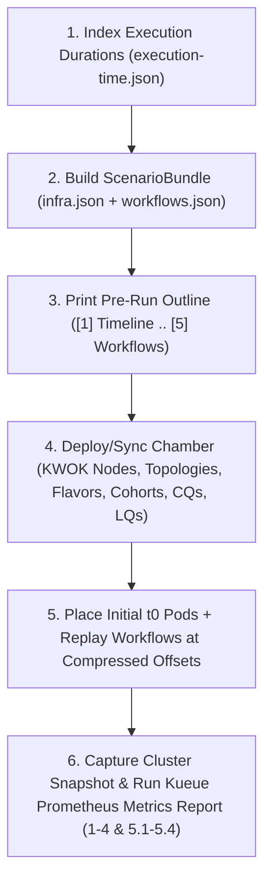

# kueue-optimizer Scenario Test Runner (`testrunner.py`) — Complete Operator & Output Interpretation Guide

This document provides comprehensive reference documentation for [`testrunner.py`](deploy/scripts/testrunner.py) and its end-of-run metrics & cluster saturation analyzer [`kueue_metrics_report.py`](deploy/scripts/kueue_metrics_report.py), with special focus on:

1. How `testrunner.py` loads, compresses, replays, and monitors scraped or synthetic scenarios inside an isolated `kueue-optimizer` chamber.
2. Every banner, status line, and summary block printed **before**, **during**, and **at the end** of a test run.
3. Exact mathematical definitions of every reported metric and aggregation (Sections `1`–`4` and `5.1`–`5.4`).
4. **Healthy cluster target values vs. red-flag warning signs** for every section, plus a structured root-cause diagnostic playbook.

---

## Table of Contents

1. [End-to-End Execution Pipeline](#1-end-to-end-execution-pipeline)
2. [CLI Flags & Common Usage Recipes](#2-cli-flags--common-usage-recipes)
3. [Pre-Run Output: Scenario & Infrastructure Description (`[1]`–`[5]`)](#3-pre-run-output-scenario--infrastructure-description-15)
4. [Live Replay Output: Periodic Cluster & Queue Ticker](#4-live-replay-output-periodic-cluster--queue-ticker)
5. [End-of-Test Output: Complete Section-by-Section Guide](#5-end-of-test-output-complete-section-by-section-guide)
   - [Block A: `KUEUE-OPTIMIZER TESTRUNNER — EXECUTION SUMMARY`](#block-a-kueue-optimizer-testrunner--execution-summary)
   - [Block B: `KUEUE-OPTIMIZER CHAMBER SUMMARY` (Report Header)](#block-b-kueue-optimizer-chamber-summary-report-header)
   - [Block C: `=== 1. Kueue Gauge Metrics ===`](#block-c--1-kueue-gauge-metrics-)
   - [Block D: `=== 2. Kueue Counter Metrics ===`](#block-d--2-kueue-counter-metrics-)
   - [Block E: `=== 3. Kueue Histogram Metrics ===`](#block-e--3-kueue-histogram-metrics-)
   - [Block F: `=== 4. Catalog Metrics Not Emitted in This Run ===`](#block-f--4-catalog-metrics-not-emitted-in-this-run-)
   - [Block G: `AGGREGATED KUEUE METRICS SUMMARY` (`5.1`–`5.4`)](#block-g-aggregated-kueue-metrics-summary-5154)
     - [`5.1` ClusterQueue & Cohort Quota Utilization per Resource Type](#section-51-clusterqueue--cohort-quota-utilization-per-resource-type)
     - [`5.2` Wait Time Across All ClusterQueues per Workload Priority](#section-52-wait-time-across-all-clusterqueues-per-workload-priority)
     - [`5.3` Total Evictions and Reclaims](#section-53-total-evictions-and-reclaims)
     - [`5.4` Effective Uninterrupted Cluster Saturation](#section-54-effective-uninterrupted-cluster-saturation)
6. [Master Diagnostic Matrix: Healthy Values vs. Warning Signs](#6-master-diagnostic-matrix-healthy-values-vs-warning-signs)
7. [Common Failure & Bottleneck Patterns (Playbook)](#7-common-failure--bottleneck-patterns-playbook)

---

## 1. End-to-End Execution Pipeline

`testrunner.py` reads a scenario directory containing three JSON Lines files conforming to [`scraper/SCRAPER-SCHEMA.md`](scraper/SCRAPER-SCHEMA.md) (`infra.json`, `workflows.json`, `execution-time.json`) and executes a deterministic 6-stage benchmark pipeline:



### Key Replay Mechanics to Keep in Mind When Reading Output

- **Time Compression (`--speedup S`)**: Every arrival offset $\Delta t_{\text{raw}}$ and every pod execution duration $d_{\text{raw}}$ from `execution-time.json` is divided by $S$ (floored at `--min-pod-duration`, default `0.1s`). Because both arrivals and durations scale by $1/S$, **dimensionless cluster saturation and queue utilization ratios are invariant under $S$** as long as $d_{\text{raw}} / S \gg$ controller scheduling overhead (`~0.2s–1.0s`).
- **Initial Jump (`--skip-initial-offset`, default `True`)**: If `infra.json` begins minutes before the first new workflow submission in `workflows.json`, `testrunner.py` fast-forwards immediately to the timestamp of the first workflow (`effective_start_epoch`), deducts that elapsed jump from the remaining lifetime of initial running pods from `t0`, and skips initial pods that already finished during the jump.
- **Initial `t0` Cluster & Quota Synchronization (`InitialWorkloadPodGroup`s + `infra-pods`)**: Running pods present at `effective_start_epoch` are partitioned into two synchronized classes before `ClusterQueue`s and `LocalQueue`s activate:
  1. **Already-admitted Kueue workloads (`InitialWorkloadPodGroup`s)**: Instantiated in their real workload namespaces as pre-admitted Kueue `PodGroup` (`ComposableJob`) `Workload` CRs (`kueue.x-k8s.io/is-group-workload: "true"`, `QuotaReserved=True`, `Admitted=True`, exact `status.admission.podSetAssignments` and TAS `topologyAssignment` when applicable) paired with pre-bound member `Pod`s (`spec.nodeName = payload.placement`, `kueue-optimizer.gke.io/initial-pod: "true"`, and `kueue.x-k8s.io/podset-unconstrained-topology: "true"` on TAS flavors so Kueue's `PodUsageReconciler` never double-counts them in `nonTasUsage`). When `ClusterQueue`s activate, `Cache.AddClusterQueue` atomically loads their quota, Cohort FairSharing usage, and TAS domain occupancy. If Kueue preempts an initial `PodGroup` `Workload` during replay (`Evicted=True`), `testrunner.py` dynamically re-submits its suspended parent workflow (`JobSet`/`Job`/etc.) so it queues and re-runs naturally.
  2. **True non-Kueue infrastructure/system pods (`infra-pods` namespace)**: Remaining unmatched `t0` pods (DaemonSets, system agents, unmanaged pods) are placed onto their recorded nodes inside the dedicated namespace `infra-pods` (`kueue.x-k8s.io/exclude=true`), occupying physical node capacity (`nonTasUsage`) without consuming Kueue `ClusterQueue` quota.
- **Pod Duration Injection**: Every pod template receives `metadata.annotations["kueue-optimizer.gke.io/pod-execution-time-seconds"] = format_pod_execution_seconds(compressed_duration_sec)` (plain numeric seconds without a unit suffix, e.g., `"10"`, `"5.5"`, `"0.1"`), instructing the KWOK pod stage controller to transition the pod from `Running` to `Succeeded` (exit code `0`) after that exact number of wall-clock seconds.
- **Signal Handling & Exit Codes**: `SIGINT` (`Ctrl+C`) and `SIGTERM` stop replay gracefully, skip the end-of-run metrics report (avoiding partial numbers), perform chamber cleanup unless `--no-cleanup` / `--skip-chamber-deploy` is set, and exit with POSIX signal codes (`130` for `SIGINT`, `143` for `SIGTERM`).

---

## 2. CLI Flags & Common Usage Recipes

### Core Flags

| Flag | Default | Purpose |
| :--- | :--- | :--- |
| `<scenario_pos>` / `--scenario-dir` (`-d`) | `testscenarios/demo` | Path to scenario directory containing `infra.json`, `workflows.json`, `execution-time.json`. |
| `--speedup` / `--time-compression` (`-s`) | `1.0` | Divides all arrival offsets and pod durations by $S > 0$. |
| `--duration` / `--max-run-seconds` | `None` (run until done) | Hard wall-clock cap on replay loop (e.g., `5m`, `10m`, `120s`). |
| `--wait-for-completion` / `--no-wait-for-completion` | `True` | When `True`, waits for all submitted workflows to finish after the last submission (up to `--duration` if set). |
| `--skip-initial-offset` / `--no-skip-initial-offset` | `True` | Jumps directly from `t0` to the timestamp of the first scheduled workflow. |
| `--status-interval` | `3s` | Interval between live progress lines during replay. |
| `--default-exec-seconds` | `10s` | Fallback raw pod duration when a workflow has no entry in `execution-time.json` and `--missing-duration-policy fallback` is used (or zero peer durations exist). |
| `--missing-duration-policy` | `impute` | Policy for never-admitted/unindexed workflows missing from `execution-time.json`: `impute` (peer median from same queue/shape with warning), `fallback` (`--default-exec-seconds` with warning), or `error` (fail fast). |
| `--interrupted-duration-multiplier` | `1.5` (external interruptions) | Multiplier (`> 1.0`) applied to observed `PartialExecution` duration for workloads interrupted by preemption, node failure, `PodsReadyTimeout`, or scrape cutoff that lack a `FullExecution` entry (`Failed`/`Deleted`-only partials default to `1.0x` unless explicitly overridden). |
| `--interrupted-duration-override` | `None` | Explicit true uninterrupted duration (`> observed partial duration`) for `PartialExecution`-only workloads: scalar (`45s`), `name=dur` pairs (`job-a=40s,job-b=60s`), or JSON map file (`@overrides.json`). |
| `--wait-for-pods-ready` / `--no-wait-for-pods-ready` | Kueue default (`30m`) | Configures or disables Kueue `waitForPodsReady` in `controller_manager_config.yaml` (in Kueue `> v0.19`, `waitForPodsReady` is enabled by default at `timeout=30m`; `--no-wait-for-pods-ready` sets `featureGates.DisableWaitForPodsReady=true`). Automatically scales `timeout`, `recoveryTimeout`, `unscheduledTimeout`, and `requeuingStrategy` backoffs by `1 / --speedup` and clamps to `<= 50%` of `--duration` (`--no-wait-for-pods-ready-cap-to-duration` disables clamping). |
| `--wait-for-pods-ready-timeout` | `30m` (raw) | Raw trace `waitForPodsReady.timeout`, scaled by `1 / --speedup` (floored at `--wait-for-pods-ready-min-timeout`, default `2s`) and clamped to `--duration`. |
| `--wait-for-pods-ready-recovery-timeout` | Unset | Raw trace `waitForPodsReady.recoveryTimeout` after pod/node failure (`0s` disables; scaled by `1 / --speedup` and clamped to `--duration`). |
| `--wait-for-pods-ready-unscheduled-timeout` | Unset | Raw trace `waitForPodsReady.unscheduledTimeout` (`<= timeout`; `0s` disables scheduling timeouts; automatically enables `featureGates.WaitForPodsReadyUnscheduledTimeout=true`). |
| `--wait-for-pods-ready-block-admission` | Unset | Configures `waitForPodsReady.blockAdmission` in Kueue controller config. |
| `--wait-for-pods-ready-backoff-limit` | Unset | Configures `waitForPodsReady.requeuingStrategy.backoffLimitCount` before workload deactivation (`spec.active=false`). |
| `--wait-for-pods-ready-backoff-base` / `--wait-for-pods-ready-backoff-max` | Unset | Raw trace `backoffBaseSeconds` / `backoffMaxSeconds` (scaled by `1 / --speedup`). |
| `--kueue-feature-gates` | `""` | Comma-separated Kueue feature gate overrides rendered into `controller_manager_config.yaml` (e.g., `TASReplaceMultipleFailedNodes=true`). Merged on top of any `featureGates` in scenario `infra.json` `Configuration`. |
| `--min-pod-duration` | `0.1s` | Floor on compressed pod duration `max(min_pod_duration, raw_duration / speedup)`. |
| `--queueing-mode` | Scenario default | Overrides `ClusterQueue.spec.queueingStrategy` (`StrictFIFO` or `BestEffortFIFO`). |
| `--fair-sharing` / `--no-fair-sharing` | Scenario `Configuration` (else `True`) | Overrides Preemption-Based Fair Sharing in `controller_manager_config.yaml` (when unset, honors any `kind: Configuration` event in `infra.json`, where omitting `fairSharing` disables Fair Sharing globally / enables Classical Preemption; falls back to `True` when no `Configuration` is present). Incompatible with `--skip-chamber-deploy`. |
| `--fair-sharing-strategies` | Scenario `Configuration` (else `LessThanOrEqualToFinalShare,LessThanInitialShare`) | Overrides `fairSharing.preemptionStrategies` in `controller_manager_config.yaml` (`LessThanOrEqualToFinalShare`, `LessThanInitialShare`, or `LessThanOrEqualToFinalShare,LessThanInitialShare`). |
| `--admission-fair-sharing` / `--no-admission-fair-sharing` | Scenario `Configuration` (else `False`) | Enables or disables Kueue `admissionFairSharing` in `controller_manager_config.yaml` (auto-enabled when `infra.json` `Configuration` specifies `admissionFairSharing` or when any `--afs-*` flag is passed; durations scale by `1 / --speedup`). |
| `--afs-usage-half-life` / `--afs-sampling-interval` / `--afs-resource-weights` | Scenario `Configuration` (else `5m` / `5s` / `{}`) | Raw trace `admissionFairSharing.usageHalfLifeTime`, `usageSamplingInterval`, and comma-separated `resource=weight` pairs (`cpu=0,google.com/tpu=1`). |
| `--cq-fair-sharing-preemption` | `False` | Opts scraped `infra.json` `ClusterQueue`s into Preemption-Based Fair Sharing (`fairSharing.weight=1` when unset, `withinClusterQueue=LowerPriority`, `reclaimWithinCohort=Any`); `False` replays `infra.json` `ClusterQueue` specs verbatim. |
| `--metrics-report` / `--no-metrics-report` | `True` | Runs `kueue_metrics_report.py` automatically at test end. |
| `--no-cleanup` / `--keep` | `False` | Leaves the chamber and `kwok-kube-apiserver` running after completion for post-mortem `kubectl` inspection. |
| `--skip-chamber-deploy` / `--reuse-chamber` | `False` | Reuses an already-deployed chamber in `--namespace` instead of deploying from scratch, and preserves the reused chamber after completion unless `--cleanup-after` is passed. |
| `--cleanup-after` | `False` | Explicitly tears down a reused chamber (`--skip-chamber-deploy`) when the run completes. |
| `--dry-run` | `False` | Prints the full scenario outline and generated YAML manifests without touching any cluster (always takes precedence over `--cleanup` / `--cleanup-workloads`). |
| `--scrape-output-dir` | `""` | Attaches `scraper/cluster-scraper` at exact chamber `t0` (right after queues and initial `t0` workloads/pods are active) and flushes live `infra.json`, `workflows.json`, and `execution-time.json` cleanly when replay finishes. |
| `--scrape-interval-sec` | `30s` | Periodic infrastructure reconciliation interval passed to `cluster-scraper --interval` when `--scrape-output-dir` is set. |
| `--scrape-hash-names` | `False` | Passes `--hash-names` to `cluster-scraper` when `--scrape-output-dir` is set. |
| `--scraper-bin` | `scraper/cluster-scraper` | Path to compiled `cluster-scraper` binary used when `--scrape-output-dir` is set. |
| `--cleanup-workloads` | `False` | Deletes only scenario workloads/queues/namespaces inside `kwok-kube-apiserver` while keeping the chamber running. |
| `--cleanup` | `False` | Tears down the host chamber namespace (verified strictly via `kueue-optimizer.gke.io/chamber=true`) and local kubeconfig. |

### Common Commands

```bash
# 1. Inspect scenario structure, node capacity, queue hierarchy, and compressed timings without deploying:
python3 deploy/scripts/testrunner.py testscenarios/demo --speedup 120 --dry-run

# 2. Run a full scenario to completion at 100x compression and print the full Kueue metrics & saturation report:
python3 deploy/scripts/testrunner.py testscenarios/demo --speedup 100

# 3. Run a large trace at the 10-minute 100%-saturation setting from the scenario README and keep the chamber alive after:
python3 deploy/scripts/testrunner.py testscenarios/demo --speedup 60 --duration 10m --no-cleanup

# 4. Re-run just the standalone Prometheus & saturation report against a running chamber:
python3 deploy/scripts/kueue_metrics_report.py \
  --namespace kueue-optimizer-chamber-01 \
  --kubeconfig ./kwok-kueue-optimizer-chamber-01.kubeconfig \
  --start-epoch <START_EPOCH> \
  --end-epoch <END_EPOCH> \
  --jobset-count <N_WORKFLOWS> \
  --total-pods <N_PODS>
```

---

## 3. Pre-Run Output: Scenario & Infrastructure Description (`[1]`–`[5]`)

Before deploying or modifying any cluster state, `testrunner.py` prints `KUEUE-OPTIMIZER TESTRUNNER — SCENARIO & INFRASTRUCTURE DESCRIPTION` containing 5 numbered subsections:

1. **`[1] TEST CASE LENGTH & TIMELINE`**:
   - Shows `Scenario Start (t0)`, `First Workload Start` (if fast-forwarded), `Scenario End (t_end)`, `Total Scraped Span`, `Workflow Arrival Span`, and `Active Execution Span` in both raw trace seconds and compressed wall-clock seconds at `--speedup`.
   - **Sanity check**: Verify that `Active Execution Span` at your chosen `--speedup` is neither too short (`< 15s`, where Prometheus's `10s` scrape interval captures only 1–2 data points) nor longer than intended. Aim for at least **45s–600s of wall-clock execution** so 30s sliding-window counter metrics (`Section 2`) and gauge percentiles (`Section 1` & `Section 5.1`) have rich statistical coverage.
2. **`[2] WORKLOAD EXECUTION TIME INDEX`**:
   - Reports total indexed workloads and event counts (`Admitted`, `PartialExecution`, `FullExecution`) plus `min / p50 / avg / p90 / max` durations both raw and at `--speedup`.
   - **Sanity check**: If compressed `p50` duration drops below `0.5s` (`min_d / speedup < 0.5s`), Kubernetes controller reconciliation latency (`~0.1s–0.3s` per pod/JobSet transition) becomes a non-trivial fraction of pod runtime and artificially lowers effective saturation (`Section 5.4`). Reduce `--speedup` so typical pods run for at least `2s–15s` of wall-clock time.
3. **`[3] CLUSTER NODES & INITIAL USAGE AT START`**:
   - Lists node pools (`ROLE`, `NODE TYPE`, `NODES`, `PER-NODE CAPACITY`, `POOL TOTAL CAPACITY`, `NODE LABELS / SELECTORS`) and initial background load from `t0` running pods in `infra-pods`.
4. **`[4] KUEUE QUEUES — QUOTA, PREEMPTION, FAIR SHARING & RECLAIM SETTINGS`**:
   - Displays all `ResourceFlavor`s, `Topology` levels, `Cohort`s, and every `ClusterQueue`'s `queueingStrategy`, `fairSharing.weight`, preemption policies (`within`, `reclaim`, `borrow`), nominal/borrowing/lending limits per flavor, and mapped `LocalQueue`s + planned workload demand per queue.
5. **`[5] WORKFLOWS TO CREATE`**:
   - Summarizes total scheduled top-level `NotAdmitted` workflows, pod counts, total CPU/memory demand, breakdown by Kubernetes `Kind` (`JobSet`, `Job`, `Pod`, `Deployment`), trigger reason (`initial_not_admitted` vs. `preempted_after_initial_admission`), and skipped already-admitted / controller-child objects.

---

## 4. Live Replay Output: Periodic Cluster & Queue Ticker

During execution, `testrunner.py` prints a single-line status snapshot every `--status-interval` (default `3s`):

```text
[12:04:15] wall=00:01:30 sim=180.0s | submitted=42/50 queued=8 (next_in=1.40s) | workloads[adm=12,pend=6,done=24/50] | pods[run=48,pend=0,succ=96] | cqs: cq-team-a(adm=6,pend=4) cq-team-b(adm=6,pend=2)
```

| Field | Meaning | Healthy Sign vs. Immediate Red Flag |
| :--- | :--- | :--- |
| `wall` / `sim` | Elapsed wall-clock time (`HH:MM:SS`) and simulated trace time (`wall * speedup`). | `sim` advances smoothly at `speedup * wall`. |
| `submitted=X/Y queued=Z` | Top-level workflows submitted so far vs. remaining in the arrival heap (`next_in=...`). | Once `queued=0 (next_in=none)`, all arrivals have been injected and the drain phase begins. |
| `workloads[adm,pend,done]` | Live Kueue `Workload` states: currently `Admitted`, waiting in queue (`pend`), and `Finished` (`done`). | **Healthy**: `done` climbs steadily as pods finish; `adm > 0` whenever `pend > 0`. **Bad sign**: `adm=0` while `pend > 0` for multiple intervals (admission deadlock, stopped queue, or unmatchable resource flavor). |
| `pods[run,pend,succ]` | Live KWOK `Pod` phases across scenario namespaces. | **Healthy**: `run > 0`, `pend = 0` (or transient `pend` clearing within 1 tick), `succ` climbing steadily. **Bad sign**: persistent `pods[pend > 0]` while `workloads[adm > 0]` means Kueue admitted a workload whose pods `kube-scheduler` **cannot bind** to any KWOK node (taint/label/topology/port mismatch)! |
| `cqs: ...` | Compact per-`ClusterQueue` admitted & pending counts. | Shows real-time queue balance, borrowing, and backlog drainage per queue. |

---

## 5. End-of-Test Output: Complete Section-by-Section Guide

When the replay finishes (either because all submitted workflows completed or `--duration` was reached), `testrunner.py` prints **two top-level banners** containing **7 distinct output blocks** in exact sequence:

1. **Block A**: `KUEUE-OPTIMIZER TESTRUNNER — EXECUTION SUMMARY` (printed directly by [`testrunner.py`](deploy/scripts/testrunner.py))
2. **Block B**: `KUEUE-OPTIMIZER CHAMBER SUMMARY` (header banner printed by [`kueue_metrics_report.py`](deploy/scripts/kueue_metrics_report.py))
3. **Block C**: `=== 1. Kueue Gauge Metrics (P50, P90, P99, AVG over demo run) ===`
4. **Block D**: `=== 2. Kueue Counter Metrics (P50, P90, P99, AVG of 30s-window increase) ===`
5. **Block E**: `=== 3. Kueue Histogram Metrics (P50, P90, MAX, AVG, COUNT, POPULATED_BUCKETS) ===`
6. **Block F**: `=== 4. Catalog Metrics Not Emitted in This Run (Inactive Features / Zero Events) ===`
7. **Block G**: `AGGREGATED KUEUE METRICS SUMMARY` (`=== 5.1 ===`, `=== 5.2 ===`, `=== 5.3 ===`, `=== 5.4 ===`)

Below is the detailed interpretation guide for every single block.

---

### Block A: `KUEUE-OPTIMIZER TESTRUNNER — EXECUTION SUMMARY`

```text
================================================================================
  KUEUE-OPTIMIZER TESTRUNNER — EXECUTION SUMMARY
================================================================================
  Scenario Directory      : <repo-root>/testscenarios/demo
  Wall-Clock Duration     : 64.2s (00:01:04)
  Initial Pods Placed     : 0
  Workflows Submitted     : 20/20 (40 total pods)
  Workloads Status        : admitted=0, pending=0, finished=20
  KWOK Pods Status        : running=0, pending=0, succeeded=40, failed=0
  ClusterQueues Status    : cluster-queue(adm=0,pend=0)
================================================================================
```

#### Field-by-Field Interpretation

| Line | What It Measures | Healthy Cluster Value | Bad Sign / What Went Wrong |
| :--- | :--- | :--- | :--- |
| `Wall-Clock Duration` | Exact wall-clock runtime `[start_epoch, end_epoch]` of the replay & wait loop. | Matches expected compressed span (`Active Execution Span / speedup`) within a few seconds when run to completion, or equals `--duration` when time-capped. | Much longer than expected (`>2x` expected duration) indicates queue starvation, head-of-line blocking under `StrictFIFO`, or unschedulable pods holding quota until timeout. |
| `Initial Pods Placed` | Count of background `t0` pods placed into `infra-pods`. | Matches `[3] Initial Usage at Start` from the pre-run outline (`0` if scenario starts on an empty cluster). | N/A (informational). |
| `Workflows Submitted` | `submitted / total_planned (total_pods)`. | **`submitted == total_planned`** (`100%` of scenario arrivals submitted) when run to completion or when `--duration` covers the arrival window. | `submitted < total_planned` means `--duration` cut off the test **before** all workflow arrivals were submitted (either increase `--speedup` or increase `--duration`). |
| `Workloads Status` | Final Kueue `Workload` snapshot: `admitted`, `pending`, `finished`. | - **Run-to-completion mode**: `admitted=0, pending=0, finished=<all>`.<br>- **Time-capped (`--duration`) saturated mode**: `admitted > 0` (cluster full at test end), `finished > 0`, `pending >= 0`. | - `finished == 0` after a non-trivial run: no workloads completed at all.<br>- `admitted == 0` while `pending > 0` at test end: scheduler stuck or cluster capacity smaller than smallest pending workload. |
| `KWOK Pods Status` | Final Kubernetes `Pod` phases across workload namespaces: `running`, `pending`, `succeeded`, `failed`. | - **`failed == 0`** always.<br>- **`pending == 0`** (every admitted pod immediately scheduled onto a KWOK node).<br>- `succeeded` equals total pods of all finished workloads (+ `running` pods if time-capped). | - **`failed > 0`**: Pod/JobSet failure or eviction race.<br>- **`pending > 0`** while `Workloads Status` shows `admitted > 0`: **Critical mismatch between Kueue quota and Kubernetes scheduler** (e.g., node selector / taint / topology block mismatch where Kueue admitted the workload but `kube-scheduler` could not bind its pods). |
| `ClusterQueues Status` | Final per-queue summary `cq(adm=X,pend=Y)`. | All queues active; `adm=0, pend=0` on full drain. | One queue stuck with `adm=0, pend>0` while sibling queues are completely idle (`adm=0, pend=0`) indicates missing `ResourceFlavor`, `stopPolicy` halt, or nominal quota < minimum workload size without cohort borrowing enabled. |

---

### Block B: `KUEUE-OPTIMIZER CHAMBER SUMMARY` (Report Header)

Printed by [`kueue_metrics_report.py`](deploy/scripts/kueue_metrics_report.py) immediately after waiting for one final Prometheus scrape after `end_epoch` (`query_end >= end_epoch`):

- Confirms `Chamber Namespace`, `Workload Namespace`, `Queueing Strategy` (`StrictFIFO` vs. `BestEffortFIFO`), exact UTC & Unix epoch timestamps (`Start Time` = `start_epoch`, `End Time` = `end_epoch`), `Total Duration`, `Total Workloads/JobSets`, and `Total Pods Executed`.
- **Important timing detail**: `kueue_metrics_report.py` queries Prometheus range vectors over `[start_epoch - max(30s, effective_step), query_end]` at `--step` (default `1.0s`, automatically scaled upward for long multi-hour windows so inclusive point counts stay `<= 10,000`, below Prometheus's 11,000-point cap) and subtracts the pre-run baseline at `baseline_time = start_epoch - 1.0s` for every Counter and Histogram. This guarantees that if you reuse a long-lived chamber (`--no-cleanup` + `--skip-chamber-deploy`), **metrics from prior runs are cleanly subtracted** and never contaminate the current test run. Note that histogram deltas use 2-snapshot instant queries (`baseline_time` and `query_end`): if a mid-run controller restart causes `end < start`, per-replica reset detection preserves post-restart observations (`end`) and emits a warning because pre-restart observations after `start_epoch` are lost (and a reset where post-restart counts exceed `start` cannot be detected from two snapshots alone).

---

### Block C: `=== 1. Kueue Gauge Metrics ===`

Reports `P50`, `P90`, `P99`, and `AVG` over `[start_epoch, end_epoch]` for every active Gauge in `KUEUE_METRICS_CATALOG`. Raw series sharing the same normalized labels (e.g., across a controller Pod restart) are merged by timestamp, and non-static gauges that Kueue deletes at zero (such as `kueue_cohort_subtree_resource_reservations`) are zero-filled only for missing timestamps on the observed Kueue scrape grid (preventing pre-first-scrape startup bias). Memory and ephemeral-storage gauges are formatted in binary SI units (`Ki` / `Mi` / `Gi` / `Ti`).

| Gauge Metric | What It Measures | Healthy Cluster Value | Bad Sign & Root Cause |
| :--- | :--- | :--- | :--- |
| `kueue_cluster_queue_status` | Indicator (`1` for active status label `status="active"`, `0` for `pending`/`terminating`). | `status=active`: `P50 = P90 = P99 = AVG = 1.00`.<br>`status=pending` / `terminating`: `0.00`. | `status=pending` has `AVG > 0`: a `ClusterQueue` was inactive because a referenced `ResourceFlavor` or `AdmissionCheck` was missing or invalid. |
| `kueue_local_queue_status` | Indicator (`1` for `active="True"`). | `active=True`: `1.00`. | `active=False` or `Unknown > 0`: `LocalQueue` points to a non-existent or inactive `ClusterQueue`. |
| `kueue_admitted_active_workloads` / `kueue_reserving_active_workloads` | Number of workloads currently admitted / holding quota in each `ClusterQueue`. | Tracks active concurrency (`> 0` during load; `AVG` proportional to arrival rate $\times$ runtime). `admitted_active` and `reserving_active` should closely track each other when no slow external `AdmissionCheck`s are configured. | Large persistent gap `reserving_active >> admitted_active`: workloads reserved quota but are stuck waiting on `AdmissionCheck`s or `WaitForPodsReady`, wasting cluster capacity while holding quota locks! |
| `kueue_pending_workloads` | Pending queue depth split by `status="active"` (eligible for scheduling cycle) vs. `status="inadmissible"` (parked after failing fit/preemption check until cluster state changes). | - Under `<100%` offered load: `AVG` small, returning to `0` at end of run.<br>- Under `>100%` saturation: non-zero queue depth that drains smoothly once arrivals stop. | - High `status=inadmissible` while cluster resources are **idle** (`Section 5.1 < 50%`): workloads cannot fit due to topology fragmentation, flavor mismatch, or single-job demand exceeding `nominalQuota + borrowingLimit`.<br>- Unbounded growth of `status=active` with slow admission rate: Kueue scheduler loop bottleneck. |
| `kueue_cluster_queue_resource_usage` & `kueue_cluster_queue_nominal_quota` | Instantaneous resource usage vs. configured nominal quota per `(cohort, cluster_queue, flavor, resource)`. | Usage approaches nominal quota (or exceeds it when borrowing from idle cohort peers). | `usage = 0.00` throughout the entire run despite submitted workloads: workloads never ran in this queue/flavor. |
| `kueue_admission_cycle_preemption_skips` | Number of workloads in a scheduling cycle that had preemption candidates but were skipped due to overlapping preemption targets. | `P50 = 0.00`, `AVG ≈ 0` (occasionally small positive spikes under heavy concurrent multi-queue contention). | High sustained `P50` / `P90` (`>> 5`): severe preemption target contention where many queues repeatedly target the same victim pods in every cycle; consider tuning priorities or `borrowWithinCohort`. |
| `kueue_cluster_queue_weighted_share` / `kueue_cohort_weighted_share` | Fair-sharing weighted share ratio of borrowed usage above nominal quota. | Balanced values across equally weighted active queues borrowing from the same cohort. | Extreme skew between queues with identical `fairSharing.weight` and continuous pending backlogs indicates fair-sharing preemption (`InCohortFairSharing`) is disabled or blocked by priority thresholds. |

---

### Block D: `=== 2. Kueue Counter Metrics ===`

Reports 30-second sliding-window increments (`P50(30s)`, `P90(30s)`, `P99(30s)`, `AVG(30s)`) plus cumulative run total (`TOTAL_INC`, reset-adjusted across controller restarts) for every active Counter:

| Counter Metric | What It Measures | Healthy Cluster Value | Bad Sign & Root Cause |
| :--- | :--- | :--- | :--- |
| `kueue_admission_attempts_total` (`result="success"` vs `result="inadmissible"`) | Number of scheduler admission attempts that succeeded vs. could not admit. | `result=success` has `TOTAL_INC >=` total admitted workloads. Under saturated load, `result=inadmissible` is non-zero as queued jobs wait for running jobs to finish. | `result=success` has `TOTAL_INC = 0` while `result=inadmissible` has hundreds/thousands of attempts: **0% admission success rate** (quota/flavor/topology misconfiguration). Extreme `inadmissible / success` ratio (`> 50:1`) indicates excessive requeue churn. |
| `kueue_quota_reserved_workloads_total` & `kueue_admitted_workloads_total` | Cumulative workloads that reserved quota and became `Admitted`. | `TOTAL_INC` equals the number of initial admissions + re-admissions after preemption (`>=` completed workloads). Both counters should match `1:1` unless AdmissionChecks rejected reservations. | `admitted_workloads_total` much lower than `quota_reserved_workloads_total`: workloads are failing or timing out during admission checks (`WaitForPodsReady` / provisioning). |
| `kueue_finished_workloads_total` | Cumulative workloads reaching `Finished=True` during the run. | In a run-to-completion test with `0` evictions, `TOTAL_INC` matches total submitted workloads (`100%` completion). | `TOTAL_INC <<` expected completions or `0.00`: workloads are hanging, starving in queue, or getting repeatedly preempted before they can finish. |
| `kueue_evicted_workloads_total` & `kueue_evicted_workloads_once_total` | Total workload eviction events vs. unique workloads evicted at least once. | - `0` when running within quota without higher-priority arrivals.<br>- When preemption/reclamation is tested, `TOTAL_INC(evicted_total) / TOTAL_INC(evicted_once_total)` is close to **`1.0`–`1.2`**. | `evicted_workloads_total >> evicted_workloads_once_total` (e.g., ratio `> 2.0`): the **same workloads are being evicted over and over again** (preemption ping-pong / thrashing)! |
| `kueue_preempted_workloads_total` | Workloads preempted per `preempting_cluster_queue` and `reason` (`InClusterQueue`, `InCohortReclamation`, `InCohortReclaimWhileBorrowing`, `InCohortFairSharing`). | Matches the intentional preemption/reclamation events driven by high-priority arrivals or lending queues reclaiming their nominal quota. | High `InClusterQueue` or `InCohortReclamation` counts accompanied by low `Section 5.4` effective saturation means preemptions are killing long-running jobs right before completion. |
| `kueue_preemption_target_recomputations_total` | Times Kueue had to recompute preemption targets within a cycle (`new_targets`, `deferred_fit`, `skipped`). | Low counts (`result=new_targets` or `deferred_fit` succeeding cleanly). | High `result=skipped` count: scheduler repeatedly unable to find non-overlapping victim sets across concurrent queues. |

---

### Block E: `=== 3. Kueue Histogram Metrics ===`

Reports latency & duration distributions from Prometheus histograms (`_bucket`, `_sum`, `_count`) over `[start_epoch, query_end]`:

- **`P50`, `P90`**: Standard Prometheus `histogram_quantile(0.50)` and `histogram_quantile(0.90)` linear interpolation over cumulative bucket deltas (clamped for cumulative monotonicity).
- **`MAX`**: Exact single observation (`total_sum`) when `COUNT == 1`; otherwise `max(histogram_quantile(1.00), AVG)`.
- **`AVG`**: Exact sample mean $\Delta\text{\_sum} / \Delta\text{\_count}$.
- **`COUNT`**: Exact number of observations recorded during `[start_epoch, query_end]`.
- **`POPULATED_BUCKETS`**: Non-empty differential bucket counts (e.g., `<=1s:18, <=2.5s:2`), showing the exact histogram bins where observations landed.

| Histogram Metric | What It Measures | Healthy Cluster Value (`kueue-optimizer` Chamber) | Bad Sign & Root Cause |
| :--- | :--- | :--- | :--- |
| `kueue_admission_attempt_duration_seconds` | Latency of a single Kueue scheduling/admission cycle (`result=success` / `inadmissible`). | **`P50 < 0.05s` (`50ms`), `P90 < 0.25s`, `AVG < 0.10s`** (even on 1,000+ node topologies). | `P90 > 1.0s` or `MAX > 5.0s`: severe scheduler algorithm slowdown (e.g., combinatorial TAS topology search explosion, large cohort tree traversal, or CPU throttling on `kueue-controller-manager` pod). |
| `kueue_workload_creation_latency_seconds` | Time from `JobSet`/`Job` creation to Kueue `Workload` object creation. | **`P50 < 0.20s`, `P90 < 1.0s`**. | `P90 > 2.0s` or `MAX > 10s`: Kubernetes API server throttling (client-side QPS/Burst saturation on `kueue-controller-manager`) or webhook latency. |
| `kueue_pod_scheduling_gate_removal_seconds` | Time from `Workload` admission (`Admitted=True`) until Kueue removes the `kueue.x-k8s.io/admission` scheduling gate from pods. | **`P50 < 0.25s`, `P90 < 1.0s`**. | `P90 > 2.0s`–`5.0s`: controller workqueue backlog or API server patch latency delaying actual pod startup after quota is already reserved (directly reduces `Section 5.4` saturation at high `--speedup`!). |
| `kueue_quota_reserved_wait_time_seconds` & `kueue_admission_wait_time_seconds` | Total queueing wait time from `Workload` creation/requeue until quota reservation / admission. | - **Uncongested cluster (`<80%` load)**: `P50 < 1.0s`, `P90 < 2.5s` (immediate admission on arrival).<br>- **Saturated cluster (`>=100%` load)**: non-zero wait times that strictly obey priority ordering (`hero < high < mid < low`). | - High wait times (`>10s–60s+`) when cluster utilization (`Section 5.1` & `5.4`) is **low (`<60%`)**: classic signature of **head-of-line blocking** (`StrictFIFO` behind a giant multi-slice job) or **topology fragmentation**.<br>- Lower priority having shorter wait time than higher priority: **priority inversion**! |
| `kueue_execution_time_seconds` | Wall-clock duration from `Admitted=True` to `Finished=True` per completed workload. | `AVG` closely matches `compressed_pod_duration` (`raw_duration / speedup`) plus small scheduling/controller overhead (`~0.2s–0.8s`). | `AVG >> compressed_pod_duration + 2s`: pods spent significant time stuck in `Pending` after `Admitted=True` waiting for `kube-scheduler` or KWOK pod controller. |
| `kueue_workload_eviction_latency_seconds` | Time from setting `Evicted=True` until all victim pods terminate and release their quota back to Pending. | **`P50 < 0.5s`, `P90 < 1.5s`** in KWOK. | `P90 > 5.0s`: slow pod termination/finalizer cleanup delaying quota handoff to the preempting high-priority workload. |
| `kueue_pods_ready_to_evicted_time_seconds` | How long a victim workload's pods ran (`Ready` -> `Evicted`) before being killed by preemption/reclamation. | Short relative to total job duration (if preempted early) or zero evictions altogether. | Large `AVG` combined with high eviction `COUNT`: workloads ran for a long time (consuming huge GPU/TPU-hours) only to be killed before completion, directly destroying `Section 5.4` effective saturation! |

---

### Block F: `=== 4. Catalog Metrics Not Emitted in This Run ===`

Lists every metric in `KUEUE_METRICS_CATALOG` that emitted zero time series during `[start_epoch, query_end]`.

- **Completely normal & healthy to see here**:
  - `multikueue_*` metrics (in single-chamber runs where MultiKueue is not configured).
  - `WaitForPodsReady (Optional)` histograms (`kueue_ready_wait_time_seconds`, `kueue_workload_recovery_wait_time_seconds`, etc.) when `waitForPodsReady` is disabled.
  - `kueue_evicted_workloads_total` / `kueue_preempted_workloads_total` / `kueue_workload_eviction_latency_seconds` in runs where zero evictions or preemptions occurred (a **good sign** in non-preemption tests!).
- **Bad sign if seen in Section 4**:
  - `kueue_cluster_queue_nominal_quota` or `kueue_cluster_queue_resource_usage` appearing in Section 4 means optional ClusterQueue resource metrics were not emitted (`metrics.enableClusterQueueResources: true` missing from `controller_manager_config.yaml`), which will leave Section `5.1` empty.
  - `kueue_admitted_workloads_total` or `kueue_admission_wait_time_seconds` appearing in Section 4 means **zero workloads were admitted** during the entire test window!

---

### Block G: `AGGREGATED KUEUE METRICS SUMMARY` (`5.1`–`5.4`)

This final four-part executive summary distills the entire benchmark run into four high-signal engineering tables:

1. **`5.1` ClusterQueue & Cohort Quota Utilization per Resource Type** — *How much quota did Kueue allocate?*
2. **`5.2` Wait Time Across All ClusterQueues per Workload Priority** — *How long did each priority tier wait?*
3. **`5.3` Total Evictions and Reclaims** — *How much preemption/reclamation churn occurred?*
4. **`5.4` Effective Uninterrupted Cluster Saturation** — *How much physical cluster capacity actually delivered uninterrupted, non-wasted compute (goodput)?*

---

#### Section `5.1`: ClusterQueue & Cohort Quota Utilization per Resource Type

```text
=== 5.1 ClusterQueue & Cohort Quota Utilization per Resource Type (P50, P90, P99, AVG) ===

  QUOTA SCOPE                      | RESOURCE       | P50     | P90     | P99     | AVG    | AVG USED / QUOTA
  ---------------------------------+----------------+---------+---------+---------+--------+--------------------
  ClusterQueue Quotas (All)        | google.com/tpu | 93.75%  | 100.00% | 100.00% | 91.20% | 933.89 / 1024
  ClusterQueue Quotas (Per-CQ, n=4)| google.com/tpu | 87.50%  | 150.00% | 200.00% | 94.10% | per-queue ratio
  Cohort Quotas (All)              | google.com/tpu | 93.75%  | 100.00% | 100.00% | 91.20% | 933.89 / 1024
```

- **How it is computed**:
  - At every scrape timestamp $t \ge \text{start\_epoch}$:
    - **`ClusterQueue Quotas (All)`**: Sums `usage` across all `(cluster_queue, flavor)` pairs divided by the total effective quota at timestamp $t$ (standalone ClusterQueue nominal quotas plus root-cohort `kueue_cohort_subtree_quota` for ClusterQueues belonging to a Cohort tree so cohort-owned nominal quota is included without double-counting):
      $$U_{\text{all}}(t) = \frac{\sum_{cq, f} \text{usage}_{cq, f}(t)}{Q_{\text{effective}}(t)} \times 100\%$$
    - **`ClusterQueue Quotas (Per-CQ, n=K)`** *(shown when $K > 1$ queues have positive nominal quota)*: Computes each individual queue's ratio $\text{usage}_{cq}(t) / \text{nominal\_quota}_{cq}(t) \times 100\%$ across all $(cq, t)$ pairs. **Note**: Individual queues actively borrowing quota from a Cohort will legitimately exceed `100.00%` (e.g., `150.00%` or `200.00%`)!
    - **`Cohort Quotas (All)`**: Sums quota & reservations across **root cohorts only** (using `kueue_cohort_info` `parent_cohort` hierarchy so child cohorts inside a multi-level Cohort tree are never double-counted; falls back to grouping ClusterQueue metrics by `cohort` label if `kueue_cohort_subtree_quota` is absent).
- **Healthy values**:
  - Under a 100%-saturation benchmark: `ClusterQueue Quotas (All)` and `Cohort Quotas (All)` show **`P50 >= 90%`, `P90 = 98%–100%`, `AVG = 85%–98%`**, and `ClusterQueue Quotas (All)` never exceeds `100.00%` (total usage across the whole cluster cannot exceed total physical quota).
  - In multi-tenant borrowing scenarios: `Per-CQ` `P90`/`P99 > 100%` proves idle quota lending & cohort borrowing are actively working!
- **Bad signs**:
  - **`AVG < 70%`** during a heavy backlog run (`kueue_pending_workloads > 0`): severe quota stranded/fragmented (e.g., `StrictFIFO` head-of-line blocking, restrictive `borrowingLimit`, or unschedulable topology slices).
  - **`Per-CQ` capped at `<= 100.00%`** when one queue has a massive backlog and sibling queues in the same Cohort sit at `0%`: cohort borrowing is broken or disabled (`cohortName` missing or `lendingLimit`/`borrowingLimit` set to `0`).
  - Large gap where **`Section 5.1 AVG` is high (`95%`) while `Section 5.4 EFFECTIVE SAT` is low (`50%`)**: quota was reserved by jobs that were later preempted/evicted (wasted compute churn) or stuck without running pods!

---

#### Section `5.2`: Wait Time Across All ClusterQueues per Workload Priority

```text
=== 5.2 Wait Time Across All ClusterQueues per Workload Priority (P50, P90, P99, AVG) ===
    Note: ADMISSIONS counts every admission observation (including re-admissions after preemption/eviction), not unique workloads.

  PRIORITY CLASS              | P50    | P90    | P99     | AVG    | ADMISSIONS
  ----------------------------+--------+--------+---------+--------+-----------
  hero-prod                   | 0.45s  | 1.10s  | 2.20s   | 0.62s  | 12
  high-prio                   | 1.80s  | 6.40s  | 11.50s  | 3.15s  | 38
  low-spot                    | 14.20s | 48.00s | 82.10s  | 21.40s | 95
  ALL (Across All Priorities) | 5.60s  | 36.80s | 78.50s  | 14.90s | 145
```

- **How it is computed**:
  - Aggregates reset-aware histogram bucket deltas (`end - start` per raw replica series, or full `end` when a controller counter reset is detected, then summed across all `ClusterQueue`s) and exact `_sum` / `_count` deltas grouped by `priority_class` label (using `kueue_admission_wait_time_seconds`, with automatic fallback to `kueue_quota_reserved_wait_time_seconds`), ordered from highest priority tier (`hero`/`urgent`/`critical` $\to$ `high` $\to$ `med`/`mid`/`normal` $\to$ `low`/`bg`/`background` $\to$ other) plus the combined `ALL (Across All Priorities)` rollup row. The `ADMISSIONS` column reports total admission observations (including re-admissions after preemption or eviction), not unique workloads.
- **Healthy values**:
  - **Strict priority monotonicity invariant**:
    $$\text{P50}(\text{hero}) \le \text{P50}(\text{high}) \le \text{P50}(\text{mid}) \le \text{P50}(\text{low}) \quad \text{and} \quad \text{P90}(\text{hero}) \le \text{P90}(\text{high}) \le \dots$$
  - High/hero priority workloads exhibit near-instant admission (`P50 < 1s–3s`, `P90 < 5s–10s`) even under heavy low-priority background load because preemption/reclamation clears space immediately.
- **Bad signs**:
  - **Priority inversion** (`AVG` or `P90` of `hero`/`high` **higher** than `low`): `withinClusterQueue: LowerPriority` or `reclaimWithinCohort: Any` preemption is disabled, or `StrictFIFO` is blocking a high-priority job behind a lower/equal-priority unschedulable job.
  - **`ADMISSIONS` count far below submitted count** in a run-to-completion test: many workloads were never admitted at all.
  - **Massive tail divergence (`P99 >> 20 * P50`)** in `high` priority: isolated starvation or topology-block deadlock for large multi-host slices.

---

#### Section `5.3`: Total Evictions and Reclaims

```text
=== 5.3 Total Evictions and Reclaims ===

  CATEGORY          | METRIC                         | TOTAL | DETAILS
  ------------------+--------------------------------+-------+----------------------------------------------------------
  Total Evictions   | kueue_evicted_workloads_total  | 6     | Unique workloads evicted once: 6
  Total Reclaims    | kueue_preempted_workloads_total| 4     | InCohortReclamation=4, InCohortReclaimWhileBorrowing=0
  Total Preemptions | kueue_preempted_workloads_total| 6     | InClusterQueue=2, Reclaims=4, FairSharing=0
```

Followed by a detailed per-label breakdown table (`Eviction (by reason/priority)` and `Preemption / Reclaim (by reason)`).

- **How to interpret each row**:
  - **`Total Evictions` vs. `Unique workloads evicted once`**:
    - Define the **Eviction Amplification Ratio**:
      $$R_{\text{evict}} = \frac{\text{Total Evictions}}{\text{Unique workloads evicted once}}$$
    - **Healthy**: $R_{\text{evict}} = 1.00$ (or $1.0\text{–}1.2$): each preempted workload was evicted once cleanly and when re-admitted ran to completion.
    - **Bad sign**: $R_{\text{evict}} > 1.5\text{–}2.0+$: workloads are caught in **eviction-requeue thrashing loops** (admitted $\to$ evicted $\to$ re-admitted $\to$ evicted again!).
  - **`Total Reclaims`**:
    - Counts cross-queue cohort reclamations where a lending `ClusterQueue` reclaimed its own `nominalQuota` back from a borrowing `ClusterQueue` (`InCohortReclamation` and `InCohortReclaimWhileBorrowing`).
    - **Healthy**: Non-zero whenever a scenario intentionally tests borrow-then-reclaim dynamics; `0` when all queues stay within their own `nominalQuota`.
  - **`Total Preemptions`**:
    - Decomposes all scheduler preemptions into:
      1. `InClusterQueue`: higher-priority workload preempted lower-priority workload inside the **same** `ClusterQueue`.
      2. `Reclaims`: lending queue reclaimed borrowed quota from another queue in the **same Cohort** (matched strictly on canonical `InCohortReclamation` and `InCohortReclaimWhileBorrowing` causes).
      3. `FairSharing`: cohort fair-sharing evicted over-share borrower workloads (`InCohortFairSharing`).
      4. `ConfigurablePreemption` (and any other custom preemption reason, displayed whenever non-zero so the breakdown always adds up to `Total Preemptions`).
    - Also inspect the breakdown table's `priority_class` label: victims should overwhelmingly be `low` / `spot` / `bg` priority classes, **never** `hero` / `critical` production workloads.

---

#### Section `5.4`: Effective Uninterrupted Cluster Saturation

```text
=== 5.4 Effective Uninterrupted Cluster Saturation ===
    Eval Window: 3600.0s | Qualifying Workloads: 1 (completed=1 [2 pods], active_at_end=0 [0 pods]) | Excluded (preempted/reclaimed/failed): 0 [0 pods] | Unadmitted: 0

  RESOURCE       | CLUSTER CAP | EFFECTIVE SAT | COMPLETED ONLY | ACTIVE AT END | FULL-DUR SAT | EFFECTIVE / EVAL CAP
  ---------------+-------------+---------------+----------------+---------------+--------------+------------------------
  google.com/tpu | 8           | 100.00%       | 100.00%        | 0.00%         | 100.00%      | 28.80k / 28.80k tpu-s
  cpu            | 360 cores   | 100.00%       | 100.00%        | 0.00%         | 100.00%      | 1.30M / 1.30M core-s
  memory         | 1,440 GiB   | 100.00%       | 100.00%        | 0.00%         | 100.00%      | 5.18M / 5.18M GiB-s
  pods           | 220         | 0.91%         | 0.91%          | 0.00%         | 0.91%        | 7200.0 / 792.00k pods-s
```

##### Exact Mathematical Definition ("Cluster Goodput")

Section `5.4` measures **strict uninterrupted useful cluster utilization ("goodput")** across every physical resource $r$ (`google.com/tpu`, `nvidia.com/gpu`, `cpu`, `memory`, `pods`):

$$\text{EFFECTIVE SAT}_r = \frac{\sum_{w \in \mathcal{W}_{\text{completed}} \cup \mathcal{W}_{\text{active\_end}}} \sum_{p \in \text{PodSets}(w)} \text{Size}_r(w, p) \cdot d_{\text{eff}}(w, p)}{\int_{t_{\text{start}}}^{t_{\text{end}}} C_r(t)\,dt} \times 100\%$$

where:

- **$T_{\text{eval}} = t_{\text{end}} - t_{\text{start}}$** (`Eval Window`): Total wall-clock duration of the evaluation window in seconds.
- **$\int_{t_{\text{start}}}^{t_{\text{end}}} C_r(t)\,dt$** (and time-averaged **$\bar{C}_r = \frac{1}{T_{\text{eval}}}\int_{t_{\text{start}}}^{t_{\text{end}}} C_r(t)\,dt$**, displayed as `CLUSTER CAP`): Physical allocatable cluster capacity integrated over `[start_epoch, end_epoch]`. When dynamic `Node` additions or deletions occur during replay, `run_scenario_replay` records a piecewise-constant `nodeCapacityTimeline` on the saturation snapshot and Section `5.4` integrates it over the evaluation window; when no timeline is present, each surviving node's allocatable capacity is clipped to its `[creationTimestamp, deletionTimestamp]` overlap with `[start_epoch, end_epoch]` (reducing to static $C_r \cdot T_{\text{eval}}$ when nodes do not change).
- **$\text{Size}_r(w, p)$**: Concurrent resource footprint of PodSet $p$ of workload $w$ (`per_pod_resource * eff_count`), evaluated per PodSet so heterogeneous roles keep independent durations and `count: 0` PodSets contribute `0` pods and `0` resources. Per-pod requests merge container `requests` + `limits` (following exact Kubernetes defaulting where extended resources like `google.com/tpu` specified in `limits` apply to `requests`), counting `initContainers`, restartable init containers (sidecars), and pod-level `spec.resources` as `resource.PodRequests` from `k8s.io/component-helpers` does, and adding `spec.overhead`.
  - When `status.admission.podSetAssignments` maps 1-to-1 to `spec.podSets` (including under **Partial Admission** where an admitted `count` is smaller than `spec.podSets[].count`, or when Kueue reserves a pod-level limit per [kubernetes-sigs/kueue#15702](https://github.com/kubernetes-sigs/kueue/issues/15702)), the admitted `podSetAssignments[].count` and `resourceUsage` are authoritative for that PodSet.
  - For multi-wave `batch/v1` `Job`s (including partially admitted Jobs where `completions > admitted_count` and distinct pods run across sequential waves), completed PodSets scale per-pod configured duration by `distinct_pods / admitted_count` (deduplicating Indexed hot-swap retries by `batch.kubernetes.io/job-completion-index`), while `active_at_end` multi-wave PodSets sum each `Succeeded` and `Running` pod's individual in-window contribution so uneven final waves and inter-wave gaps are never over-credited.
  - *Concrete sanity example*: A `2`-pod workload requesting `4` `google.com/tpu` in each pod has $\text{Size}_{\text{tpu}}(w, p) = 2 \times 4 = 8\text{ TPUs}$. Running on two `4`-TPU nodes ($\bar{C}_{\text{tpu}} = 2 \times 4 = 8\text{ TPUs}$) for $T_{\text{eval}} = 3600\text{s}$ produces $(8 \times 3600) / (8 \times 3600) = 28,800 / 28,800 = \mathbf{100.00\%}$.
- **Strict Qualification Rules**:
  1. **$\mathcal{W}_{\text{completed}}$ (`COMPLETED ONLY`)**: Workloads that **fully completed (`Finished=True` without failure, or all pods `Succeeded`) during `[start_epoch, end_epoch]`**. Each PodSet's in-window execution duration $d_{\text{eff}}(w, p)$ is bounded by both its own configured duration and actual in-window runtime.
  2. **$\mathcal{W}_{\text{active\_end}}$ (`ACTIVE AT END`)**: Workloads with **`Admitted=True`** (not merely `QuotaReserved=True` waiting on `AdmissionChecks`) that are **actively running uninterrupted at the exact end of the test (`end_epoch`)** with at least one `Running`/`Succeeded` pod (or no pod objects yet in synthetic snapshots). Each PodSet's $d_{\text{eff}}(w, p)$ equals its uninterrupted in-window elapsed runtime $t_{\text{end}} - \max(t_{\text{start}}, t_{\text{admit}})$ (capped at its own configured duration, or summed per pod for multi-wave later waves).
  3. **Excluded Workloads (`Excluded (preempted/reclaimed/failed)` — `0%` contribution)**: Any workload that was preempted, evicted due to cohort reclamation, requeued, or failed without completing and is not actively running at `end_epoch` contributes **exact `0`** to `EFFECTIVE SAT`. All compute cycles spent before its interruption are treated as **wasted work ("badput")**.
  4. **Admitted with Pending Pods (`Admitted (pending pods)` — `0%` contribution, shown when `> 0`)**: Non-interrupted workloads with `Admitted=True` whose instantiated pods all remain `Pending` at `end_epoch` (e.g., node-selector, taint, or TAS mismatch) contribute `0%` without inflating `Excluded` or contradicting `Unadmitted`.
  5. **Unadmitted Workloads (`Unadmitted` — `0%` contribution)**: Workloads never admitted (`Admitted != True`, including `QuotaReserved=True` workloads still blocked on unsatisfied `AdmissionChecks` and `Inadmissible` workloads).

##### Column-by-Column Meaning

| Column | Formula & Meaning |
| :--- | :--- |
| `RESOURCE` | Resource name, ordered with accelerators first (`google.com/tpu`, `nvidia.com/gpu`), then `cpu`, `memory`, `pods`. |
| `CLUSTER CAP` | Time-averaged physical allocatable capacity $\bar{C}_r$ over `[start_epoch, end_epoch]` (equals static $C_r$ when cluster nodes do not change). |
| `EFFECTIVE SAT` | **Primary headline metric**: `(COMPLETED ONLY + ACTIVE AT END)` uninterrupted resource-seconds divided by $\int_{t_{\text{start}}}^{t_{\text{end}}} C_r(t)\,dt$. |
| `COMPLETED ONLY` | Portion of `EFFECTIVE SAT` delivered by workloads that finished completely before `end_epoch`. |
| `ACTIVE AT END` | Portion of `EFFECTIVE SAT` delivered so far by workloads still actively running at `end_epoch`. |
| `FULL-DUR SAT` | Total full-run resource-seconds ($\sum_{w,p} \text{Size}_r(w, p) \cdot d_{\text{full}}(w, p) / \int C_r(t)\,dt$) including the remaining future tail of `active_at_end` workloads (can exceed `100%` in `--duration` time-capped runs when long jobs are in flight at `end_epoch`). |
| `EFFECTIVE / EVAL CAP` | Raw numerator and integrated denominator in compact SI units (`28.80k / 28.80k tpu-s`, `core-s`, `GiB-s`, `pods-s`). |

##### Healthy Values vs. Red Flags in Section `5.4`

- **Healthy values**:
  - **Bottleneck accelerator (`google.com/tpu` / `nvidia.com/gpu`)**:
    - On a 100%-offered-saturation benchmark (e.g., using the scenario `README.md`'s recommended 5m/10m 100%-saturation settings): **`EFFECTIVE SAT = 85%–99%`** for single-host/small-slice workloads, or **`75%–95%`** for heterogeneous multi-slice (`4x4x4` + `2x4x4` + `2x2x2`) packing scenarios.
    - On an under-saturated trace (e.g., a raw 6-hour trace whose offered load is `42%` of cluster capacity): **`EFFECTIVE SAT` should match the scenario's theoretical offered saturation (`~40%–42%`) within `1%–3%`**.
  - **Secondary resources (`pods`, `memory`, `cpu`)**: `pods` saturation is naturally low (`0.5%–5%`) on TPU/GPU clusters because each node allows `110` pods while a single TPU pod consumes all `4` or `8` chips on the node — **this is completely normal and expected**. Always judge cluster saturation by the **primary constrained resource** (`google.com/tpu` / `nvidia.com/gpu` on accelerator clusters, or `cpu` / `memory` on CPU-only clusters).
- **Bad signs**:
  - **`EFFECTIVE SAT` is `>10%–20%` below `Section 5.1 Quota Utilization AVG`**: High wasted work from preemptions/evictions (`Excluded (preempted/reclaimed/failed)` count in the subtitle will be high) or pods sitting in `Pending` after Kueue admission (the subtitle then shows a non-zero `Admitted (pending pods)` count).
  - **`COMPLETED ONLY = 0.00%`** in a run that was supposed to complete jobs: `--duration` was shorter than the shortest compressed workload duration, or pods never transitioned to `Succeeded`.
  - **`EFFECTIVE SAT = 0.00%`** with high `Unadmitted`: zero workloads ran.

---

## 6. Master Diagnostic Matrix: Healthy Values vs. Warning Signs

Use this quick-reference scorecard at the end of any `testrunner.py` run:

| Output Section / Metric | Healthy Cluster Range | Warning / Bad Sign | Primary Root Cause to Check |
| :--- | :--- | :--- | :--- |
| **Execution Summary: `KWOK Pods Status`** | `failed=0`, `pending=0` | `failed > 0` or persistent `pending > 0` while `admitted > 0` | Node selector / taint / topology block mismatch between Kueue `ResourceFlavor` and KWOK `Node` labels. |
| **Sec 1 Gauge: `kueue_cluster_queue_status`** | `status=active`: `1.00` | `status=pending`: `> 0.00` | Missing `ResourceFlavor`, `Topology`, or inactive `AdmissionCheck`. |
| **Sec 3 Hist: `kueue_admission_attempt_duration_seconds`** | `P50 < 0.05s`, `P90 < 0.25s` | `P90 > 1.0s` or `MAX > 5.0s` | Scheduler cycle bottleneck (TAS topology search complexity or controller CPU throttling). |
| **Sec 3 Hist: `kueue_pod_scheduling_gate_removal_seconds`** | `P50 < 0.25s`, `P90 < 1.0s` | `P90 > 2.0s` | API server QPS/Burst throttling or controller workqueue backlog. |
| **Sec 5.1: `ClusterQueue Quotas (All)` (`AVG`)** | `85%–99%` (under 100% offered load) | `< 70%` while `kueue_pending_workloads > 0` | `StrictFIFO` head-of-line blocking, restrictive `borrowingLimit`, or slice fragmentation. |
| **Sec 5.2: `Wait Time` across Priority Classes** | Strict monotonicity: `hero < high < mid < low` | `hero`/`high` wait time $\ge$ `low` wait time | Priority inversion (`withinClusterQueue` / `reclaimWithinCohort` preemption disabled). |
| **Sec 5.3: `Total Evictions / Unique Evicted Once`** | `0` evictions, or ratio `1.0–1.2x` | Ratio `> 1.5x–2.0x+` | Preemption/requeue thrashing loop (same jobs repeatedly evicted and re-admitted). |
| **Sec 5.4: `EFFECTIVE SAT` (Primary Accelerator / CPU)** | Matches offered saturation (`85%–99%` when saturated); within `2%–5%` of `Sec 5.1 AVG` | Gap `(Sec 5.1 AVG - Sec 5.4 EFFECTIVE SAT) > 15%` | Preemption wasted compute ("badput" from long-running jobs killed before completion) or post-admission pod scheduling delay. |

---

## 7. Common Failure & Bottleneck Patterns (Playbook)

### Pattern 1: High Quota Utilization (`Sec 5.1 ≈ 95%`), Low Effective Saturation (`Sec 5.4 ≈ 45%`)

- **Signature**: `Section 5.1` shows the cluster quota was almost 100% full all run, yet `Section 5.4` reports low `EFFECTIVE SAT` and a high `Excluded (preempted/reclaimed/failed)` workload/pod count, alongside high `Section 5.3 Total Evictions` and high `kueue_pods_ready_to_evicted_time_seconds`.
- **Meaning**: **Preemption goodput collapse ("badput")**. Long-running borrowing or low-priority workloads ran for most of their duration before being preempted right before finishing, so all their GPU/TPU-seconds produced zero completed output.
- **Remediation**: Enable fair-sharing weights, cap `borrowingLimit` on long non-checkpointable jobs, set `maxPriorityThreshold` on `borrowWithinCohort`, or lower `--speedup` if artificial arrival bursts triggered unnecessary preemptions.

### Pattern 2: Both `Sec 5.1` (`~52%`) and `Sec 5.4` (`~50%`) Are Low Despite Large Pending Queue

- **Signature**: `kueue_pending_workloads{status="active"|"inadmissible"}` stays high all run, `Section 5.2` wait times are large, yet nearly half the cluster sits idle (`AVG USED / QUOTA` around half of capacity).
- **Meaning**: **Head-of-line blocking or topology fragmentation**. A large multi-slice job (e.g., a 64-chip or 128-chip slice) at the head of a `StrictFIFO` queue is waiting for contiguous topology capacity while blocking smaller jobs behind it that could immediately fill the idle nodes.
- **Remediation**: Compare `--queueing-mode StrictFIFO` vs. `--queueing-mode BestEffortFIFO` directly on the exact same scenario to quantify the exact utilization & wait-time gain of out-of-order admission.

### Pattern 3: `Workloads Status: admitted > 0` While `KWOK Pods Status: pending > 0, running = 0`

- **Signature**: `Section 5.1` shows positive quota usage, `Section 5.4` shows low/zero completed saturation, and `KUEUE-OPTIMIZER TESTRUNNER — EXECUTION SUMMARY` shows pods stuck in `pending`.
- **Meaning**: Kueue reserved quota and removed scheduling gates, but Kubernetes `kube-scheduler` could not bind pods onto KWOK nodes (typically missing `kwok.x-k8s.io/node=fake:NoSchedule` toleration, missing node label required by `nodeSelector`, or missing extended resource on `Node.status.allocatable`).
- **Remediation**: Re-run with `--no-cleanup` and inspect `kubectl --kubeconfig ./kwok-<ns>.kubeconfig describe pod <pending-pod>` to see the exact `FailedScheduling` event message.

### Pattern 4: Effective Saturation Drops from `96%` at `--speedup 60` to `72%` at `--speedup 2000`

- **Signature**: Zero evictions, zero pending pods, everything completes (`100%` `finished`), yet `Section 5.4 EFFECTIVE SAT` declines when `--speedup` is pushed very high.
- **Meaning**: **Compression overhead dilution**. When a 600s raw job is compressed by `2000x`, its simulated runtime is `0.30s`, while real Kubernetes + JobSet + Kueue controller reconciliation (`Create JobSet -> Create Workload -> Admit -> Remove Gate -> Schedule Pod -> KWOK Stage -> Complete JobSet -> Finish Workload`) takes `~0.15s–0.30s` of fixed wall-clock latency per job.
- **Remediation**: Keep `--speedup` in the sweet spot where `p50_raw_duration / speedup >= 3s–10s` (as automatically calculated in each scenario's generated `README.md` under *Recommended Settings for 100% Cluster Saturation in 5m / 10m*).
