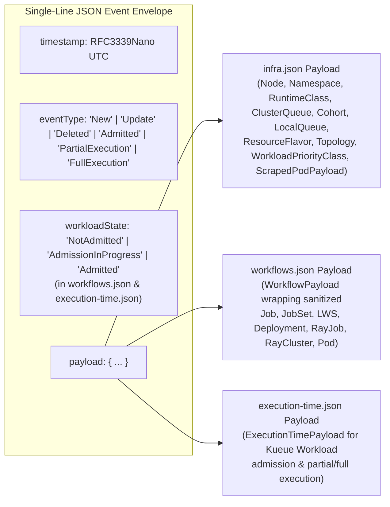
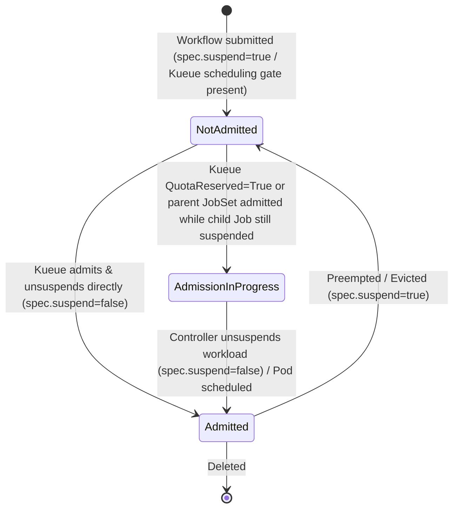
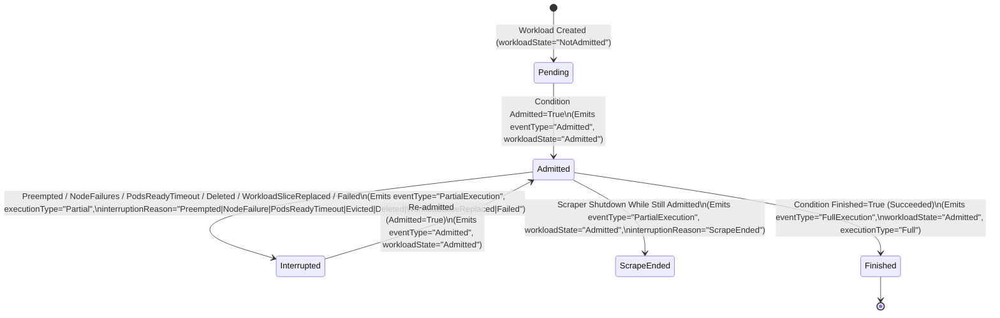

# Kubernetes & Kueue Load Test Cluster Scraper — Output Format & Schema Specification (`SCRAPER-SCHEMA.md`)

This document specifies the exact JSON Lines (NDJSON) file format, event envelope structure, workload admission state metadata (`workloadState`), payload schemas, sanitization rules, and anonymization behavior produced by `cluster-scraper` (`./scraper`).

---

## 1. Overview

`cluster-scraper` connects to a Kubernetes + Kueue cluster and records cluster state, submitted workflows, and workload execution timings into three streaming JSON Lines event log files:

| File | Default Flag | Purpose |
| :--- | :--- | :--- |
| `infra.json` | `--infra-file` | Periodic state & real-time watch changes of sanitized `Node`s (scheduling-relevant spec & status), `Namespace`s, `RuntimeClass`es, `PriorityClass`es (`scheduling.k8s.io/v1`), Kueue controller `Configuration` (`ConfigMap/kueue-manager-config` + `Deployment/kueue-controller-manager` `--feature-gates` CLI overrides), `ClusterQueue`s, `Cohort`s, `LocalQueue`s, `ResourceFlavor`s, `Topology` objects, `WorkloadPriorityClass`es, and scheduled/running `Pod` placements, resource requests, and real-time lifecycle timestamps. |
| `workflows.json` | `--workflows-file` | Watch-driven creation, update, and deletion events of Kueue-managed `Job`s, `JobSet`s, `LeaderWorkerSet`s, `Deployment`s, `RayJob`s, `RayCluster`s, and standalone Kueue-managed `Pod`s (sorted by `creationTime` at `t0` and retaining watch `ResourceVersion`s across reconnects), with top-level `workloadState` admission metadata (`"NotAdmitted"`, `"AdmissionInProgress"`, `"Admitted"`) and payloads sanitized of all business-specific details. |
| `execution-time.json` | `--execution-time-file` | Watch-driven Kueue `Workload` admission timestamps (`Admitted`), interrupted/deleted runs (`PartialExecution`), and non-interrupted completions (`FullExecution`), with top-level `workloadState` metadata. |

### On-Disk File Format (One Event Per Line / JSON Lines)
Each output file is written in **JSON Lines (NDJSON)** format:
- **One event per line**: Every line in `infra.json`, `workflows.json`, and `execution-time.json` is an independent, compact (non-pretty-printed) UTF-8 JSON object terminated by a single newline (`\n`).
- **No outer array wrapper**: Files do **not** wrap events in `[` ... `]`, so consumers never need to load or parse the entire file in memory.
- **Append-only streaming**: As each event arrives, `JSONEventLog` serializes the event on a single line (`json.Marshal(event)` + `\n`), appends it to the file (`O_APPEND`), and `fsync`s.
- **$O(1)$-memory line-by-line parsing**: Consumers can stream and parse arbitrarily large trace files one line at a time (`bufio.Scanner` / `json.Unmarshal` in Go, `for line in f: json.loads(line)` in Python, `jq -c`, etc.).

#### On-Disk Single-Line Format Examples
- `infra.json` (2 lines):
```json
{"timestamp":"2026-10-30T12:06:03.831680565Z","eventType":"New","payload":{"apiVersion":"v1","kind":"Pod","name":"jobset-01-workers-0-0-lmxm2","namespace":"ai-lab","placement":"kwok-node-0","resourceRequest":{"cpu":"1","memory":"11Gi"},"schedulingTime":"2026-10-30T12:06:01Z","firstNoticeTime":"2026-10-30T12:06:01Z"}}
{"timestamp":"2026-10-30T12:09:17.68496896Z","eventType":"Deleted","payload":{"apiVersion":"v1","kind":"Pod","name":"jobset-01-workers-0-0-lmxm2","namespace":"ai-lab","placement":"kwok-node-0","resourceRequest":{"cpu":"1","memory":"11Gi"},"schedulingTime":"2026-10-30T12:06:01Z","firstNoticeTime":"2026-10-30T12:06:01Z","deletionTime":"2026-10-30T12:09:17Z"}}
```
- `workflows.json` (2 lines):
```json
{"timestamp":"2026-10-30T12:06:01.456886929Z","eventType":"New","workloadState":"NotAdmitted","payload":{"objectKind":"JobSet","name":"jobset-01","namespace":"ai-lab","creationTime":"2026-10-30T12:06:01Z","localQueueName":"ai-lab-lq","object":{...}}}
{"timestamp":"2026-10-30T12:06:01.511203122Z","eventType":"Update","workloadState":"Admitted","payload":{"objectKind":"JobSet","name":"jobset-01","namespace":"ai-lab","creationTime":"2026-10-30T12:06:01Z","localQueueName":"ai-lab-lq","object":{...}}}
```
- `execution-time.json` (2 lines):
```json
{"timestamp":"2026-10-30T12:06:01.494857597Z","eventType":"Admitted","workloadState":"Admitted","payload":{"workloadName":"jobset-jobset-01-3165a","namespace":"ai-lab","ownerKind":"JobSet","ownerName":"jobset-01","ownerAPIVersion":"jobset.x-k8s.io/v1alpha2","localQueueName":"ai-lab-lq","clusterQueueName":"ai-lab-cq","creationTime":"2026-10-30T12:06:01Z","admittedTime":"2026-10-30T12:06:01Z","preempted":false,"reason":"Admitted","message":"The workload is admitted"}}
{"timestamp":"2026-10-30T12:06:12.878986519Z","eventType":"FullExecution","workloadState":"Admitted","payload":{"executionType":"Full","workloadName":"jobset-jobset-01-3165a","namespace":"ai-lab","ownerKind":"JobSet","ownerName":"jobset-01","ownerAPIVersion":"jobset.x-k8s.io/v1alpha2","localQueueName":"ai-lab-lq","clusterQueueName":"ai-lab-cq","creationTime":"2026-10-30T12:06:01Z","admittedTime":"2026-10-30T12:06:01Z","endTime":"2026-10-30T12:06:12Z","executionDurationSeconds":11,"executionDuration":"11s","preempted":false,"reason":"Succeeded","message":"jobset completed successfully"}}
```

---

## 2. Common Event Envelope (All Files)

In **all three files** (`infra.json`, `workflows.json`, and `execution-time.json`), every line is an independent JSON object sharing a top-level envelope that strictly separates **event metadata** (`timestamp`, `eventType`, and for workload files `workloadState`) from the **event payload** (`payload`).

On disk (single line in `workflows.json` and `execution-time.json`):
```json
{"timestamp":"2026-10-30T12:06:01.494857597Z","eventType":"New","workloadState":"NotAdmitted","payload":{...}}
```

On disk (single line in `infra.json`):
```json
{"timestamp":"2026-10-30T12:06:01.494857597Z","eventType":"New","payload":{...}}
```

Expanded view (for schema readability only):
```json
{
  "timestamp": "2026-10-30T12:06:01.494857597Z",
  "eventType": "New",
  "workloadState": "NotAdmitted",
  "payload": {
    ...
  }
}
```

### Envelope Fields

| Field | JSON Type | Present In | Description |
| :--- | :--- | :--- | :--- |
| `timestamp` | `string` (RFC3339Nano UTC) | All 3 files (**Required**) | Wall-clock UTC timestamp when the scraper observed and recorded the event (e.g., `"2026-10-30T12:06:01.494857597Z"`). |
| `eventType` | `string` (PascalCase) | All 3 files (**Required**) | Type of event. Always starts with an uppercase letter:<ul><li>In `infra.json` and `workflows.json`: `"New"`, `"Update"`, `"Deleted"`</li><li>In `execution-time.json`: `"Admitted"`, `"PartialExecution"`, `"FullExecution"`</li></ul> |
| `workloadState` | `string` (PascalCase) | `workflows.json` & `execution-time.json` (**Required**) | Current admission state of the workload at the moment the event was recorded. Always one of:<ul><li>`"NotAdmitted"` — Workload is queued/suspended waiting for quota or has been preempted/evicted.</li><li>`"AdmissionInProgress"` — Quota is reserved (`QuotaReserved=True`) or parent `JobSet` is admitted while child resources (`Job`, pod group) are still being unsuspended/admitted.</li><li>`"Admitted"` — Workload has been admitted by Kueue (`Admitted=True`) and unsuspended (`spec.suspend=false`).</li></ul> |
| `payload` | `object` | All 3 files (**Required**) | Event-specific payload object whose schema depends on the file and resource kind (detailed in Sections 3, 4, and 5). |



---

## 3. `infra.json` Schema

`infra.json` captures an initial $t_0$ snapshot of all cluster infrastructure resources, refreshes non-watched resources (`Namespace`, `RuntimeClass`, `PriorityClass`, and Kueue `Configuration`) periodically every `--interval` (default `60s`), and watches `v1/Node`, `v1/Pod`, and Kueue infrastructure resources (`ClusterQueue`, `Cohort`, `LocalQueue`, `ResourceFlavor`, `Topology`, `WorkloadPriorityClass`) in real time (reconciling on `410 Gone` relists) to capture exact mid-scenario node failures/recoveries/additions/deletions, queue/quota updates, and scheduled/running pod placement and termination/deletion timestamps.

### 3.1 Allowed `eventType` Values in `infra.json`

| `eventType` | Emission Trigger |
| :--- | :--- |
| `"New"` | Emitted the first time an object (`Node`, `Namespace`, `RuntimeClass`, `ClusterQueue`, `Cohort`, `LocalQueue`, `ResourceFlavor`, `Topology`, `WorkloadPriorityClass`, or scheduled/running `Pod`) is observed by the scraper (including post-`t0` replacement/scale-up `Node`s and newly created Kueue infrastructure objects via real-time watches). |
| `"Update"` | Emitted immediately via a real-time watch (`Node`, `ClusterQueue`, `Cohort`, `LocalQueue`, `ResourceFlavor`, `Topology`, `WorkloadPriorityClass`, `Pod`) or on a periodic scrape tick (`Namespace`, `RuntimeClass`, `PriorityClass`, `Configuration`) when a tracked object's canonical SHA-256 digest (ignoring volatile `metadata.resourceVersion`, `metadata.generation`, and `status.conditions[].lastHeartbeatTime` so periodic kubelet heartbeats do not produce spurious diffs) changes compared to its previously recorded state (e.g., `Ready: True -> False` node failure, `NoExecute`/`NoSchedule` taints, `spec.unschedulable: true`, `Ready: False -> True` node recovery, or quota updates). |
| `"Deleted"` | Emitted immediately when a watched infrastructure object (`Node`, `Pod`, `ClusterQueue`, `Cohort`, `LocalQueue`, `ResourceFlavor`, `Topology`, `WorkloadPriorityClass`) receives a `DELETED` watch event (or transitions to terminal `Succeeded`/`Failed` for Pods, or disappears on a `410 Gone` relist), or when a periodically scraped infrastructure object (`Namespace`, `RuntimeClass`, `PriorityClass`, `Configuration`) disappears between periodic scrapes. |

### 3.2 Discriminating Payload Types in `infra.json`

Every `payload` object in `infra.json` contains top-level `"apiVersion"` and `"kind"` fields:

| `payload.kind` | `payload.apiVersion` | Includes `.status`? | Name Hashed with `--hash-names`? |
| :--- | :--- | :--- | :--- |
| `"Node"` | `"v1"` | **Yes** (scheduling-only: `capacity`, `allocatable`, `conditions`, `phase`) | **No** (plain name) |
| `"Namespace"` | `"v1"` | **No** (status omitted) | **No** (plain name) |
| `"RuntimeClass"` | `"node.k8s.io/v1"` | **No** (status omitted) | **No** (plain name) |
| `"PriorityClass"` | `"scheduling.k8s.io/v1"` | **No** (status & description omitted) | **No** (plain name) |
| `"ClusterQueue"` | `"kueue.x-k8s.io/v1beta2"` | **No** (status omitted) | **No** (plain name) |
| `"Cohort"` | `"kueue.x-k8s.io/v1beta2"` | **No** (status omitted) | **No** (plain name) |
| `"LocalQueue"` | `"kueue.x-k8s.io/v1beta2"` | **No** (status omitted) | **No** (plain name) |
| `"ResourceFlavor"` | `"kueue.x-k8s.io/v1beta2"` | **No** (status omitted) | **No** (plain name) |
| `"Topology"` | `"kueue.x-k8s.io/v1beta2"` | **No** (status omitted) | **No** (plain name) |
| `"WorkloadPriorityClass"` | `"kueue.x-k8s.io/v1beta2"` | **No** (status & description omitted) | **No** (plain name) |
| `"Configuration"` | `"config.kueue.x-k8s.io/v1beta2"` (normalized from `"v1beta1"` inputs) | **No** (sanitized scheduling policy fields only) | **No** (cluster-singleton policy) |
| `"Pod"` | `"v1"` | **No** (`ScrapedPodPayload` only) | **Yes** (`h-<32-hex>` HMAC-SHA256 when `--hash-names` is set) |

---

### 3.3 `Node` Payload (`payload.kind == "Node"`)

Stores a sanitized Kubernetes `v1/Node` object retaining only scheduling-relevant fields:
- `metadata`: `metadata.managedFields` and `metadata.finalizers` are stripped, `metadata.ownerReferences` are sanitized (and `metadata.uid` / `ownerReferences[].uid` are omitted when `--hash-names` is enabled), `metadata.annotations` retains only keys under the `kubernetes.io`, `k8s.io`, `x-k8s.io`, and `kueue-optimizer.gke.io` domains and their subdomains (excluding sensitive keys and prefixes such as `kubectl.kubernetes.io/last-applied-configuration`, `kubectl.kubernetes.io/default-*container`, `kubernetes.io/created-by`, `csi.volume.kubernetes.io/nodeid`, `alpha.kubernetes.io/provided-node-ip`, `kueue.x-k8s.io/multikueue-origin-uid`, `scheduler.alpha.kubernetes.io/node-selector`, `provreq.kueue.x-k8s.io/*`, `seccomp.security.alpha.kubernetes.io/*`, and `apparmor.security.beta.kubernetes.io/*`), and `metadata.labels` preserves scheduling/topology/hardware labels (including vendor hardware labels such as `gpu.nvidia.com/model`) while stripping cloud/cluster-identifying keys (such as `cloud.google.com/gke-cluster-name`, `cloud.google.com/project`, `iam.gke.io/node-service-account`, `alpha.eksctl.io/cluster-name`, and `kubernetes.azure.com/cluster`) and (when `--hash-names` is enabled) deterministically hashing values for organizational keys (`owner`, `team`, `customer`, `project`, `cost-center`, `tenant`, ...) and `--extra-hash-labels`.
- `spec`: retains only `taints` (with taint `value` hashed whenever `key` matches organizational keys or `--extra-hash-labels`) and `unschedulable` (omitting `providerID`, `podCIDR`, `podCIDRs`, and `configSource`).
- `status`: retains only `capacity`, `allocatable`, `conditions`, and `phase` (omitting `images`, `addresses`, `nodeInfo`, `volumesInUse`, `volumesAttached`, `daemonEndpoints`, `config`, `runtimeHandlers`, and `features`; when `--hash-names` is enabled, free-form `status.conditions[].message` strings are redacted while structured `type`, `status`, and `reason` remain intact).

On disk (single line in `infra.json`):
```json
{"timestamp":"2026-10-30T12:05:53.431067532Z","eventType":"New","payload":{"apiVersion":"v1","kind":"Node","metadata":{"annotations":{"kwok.x-k8s.io/node":"fake"},"creationTimestamp":"2026-10-30T12:05:13Z","labels":{"beta.kubernetes.io/arch":"amd64","beta.kubernetes.io/os":"linux","kubernetes.io/arch":"amd64","kubernetes.io/hostname":"kwok-node-0","kubernetes.io/os":"linux","kubernetes.io/role":"agent","type":"kwok"},"name":"kwok-node-0","resourceVersion":"324","uid":"a4971110-16a8-4b65-a2a0-01ef11df47a2"},"spec":{"taints":[{"effect":"NoSchedule","key":"kwok.x-k8s.io/node","value":"fake"}]},"status":{"allocatable":{"cpu":"4","memory":"16Gi","pods":"110"},"capacity":{"cpu":"4","memory":"16Gi","pods":"110"},"conditions":[{"lastHeartbeatTime":"2026-10-30T12:05:44Z","lastTransitionTime":"2026-10-30T12:05:14Z","message":"kubelet is posting ready status","reason":"KubeletReady","status":"True","type":"Ready"}],"phase":"Running"}}}
```

---

### 3.4 `Namespace`, `RuntimeClass`, `ClusterQueue`, `Cohort`, `LocalQueue`, `ResourceFlavor`, `Topology`, and `WorkloadPriorityClass` Payloads

Stores the Kubernetes/Kueue object (`apiVersion`, `kind`, `metadata`, plus `spec` or top-level `RuntimeClass`/`WorkloadPriorityClass` scheduling fields), **excluding `.status`**, `WorkloadPriorityClass.description`, `metadata.managedFields`, and any `metadata.annotations` outside the allowed `kubernetes.io`, `k8s.io`, `x-k8s.io`, and `kueue-optimizer.gke.io` domains (and their subdomains) or on the sensitive annotation denylist. When `--hash-names` is enabled, values for sensitive label keys (`owner`, `team`, `customer`, `project`, `cost-center`, ...) and `--extra-hash-labels` (including `ClusterQueue.spec.namespaceSelector`, `ResourceFlavor.spec.nodeLabels`, and `RuntimeClass.scheduling.nodeSelector`) are deterministically hashed (`h-<32-hex>`) identically to workflow objects.

On disk (single line in `infra.json` for `ClusterQueue`):
```json
{"timestamp":"2026-10-30T12:05:53.443652256Z","eventType":"New","payload":{"apiVersion":"kueue.x-k8s.io/v1beta2","kind":"ClusterQueue","metadata":{"creationTimestamp":"2026-10-30T12:05:14Z","finalizers":["kueue.x-k8s.io/resource-in-use"],"generation":1,"name":"ai-lab-cq","resourceVersion":"249","uid":"68ce46db-48b0-4271-903a-d6eb4819ab56"},"spec":{"namespaceSelector":{},"preemption":{"reclaimWithinCohort":"Never","withinClusterQueue":"Never"},"queueingStrategy":"StrictFIFO","resourceGroups":[{"coveredResources":["cpu","memory"],"flavors":[{"name":"default-flavor","resources":[{"name":"cpu","nominalQuota":"40"},{"name":"memory","nominalQuota":"160Gi"}]}]}]}}}
```

On disk (single line in `infra.json` for `Cohort`):
```json
{"timestamp":"2026-10-30T12:05:53.450112904Z","eventType":"New","payload":{"apiVersion":"kueue.x-k8s.io/v1beta2","kind":"Cohort","metadata":{"creationTimestamp":"2026-10-30T12:05:14Z","generation":1,"name":"main-cohort","resourceVersion":"245","uid":"9f2b1b24-1b7d-4e54-8f31-18e62f9a3d10"},"spec":{"fairSharing":{"weight":"2"},"parentName":"root-cohort","resourceGroups":[{"coveredResources":["cpu"],"flavors":[{"name":"default-flavor","resources":[{"borrowingLimit":"8","lendingLimit":"4","name":"cpu","nominalQuota":"16"}]}]}]}}}
```

On disk (single line in `infra.json` for sanitized Kueue controller `Configuration`, scraped from `ConfigMap/kueue-manager-config` in `--kueue-namespace` `kueue-system` retaining strictly scheduling-policy fields `fairSharing`, `admissionFairSharing`, `waitForPodsReady`, `featureGates`, `resources`, and `manageJobsWithoutQueueName` while stripping all internal TLS/webhook/metrics/leaderElection/clientConnection fields; omitting `fairSharing` signifies global Fair Sharing disabled / Classical Preemption):
```json
{"timestamp":"2026-10-30T12:05:53.455000000Z","eventType":"New","payload":{"admissionFairSharing":{"resourceWeights":{"cpu":0,"google.com/tpu":1,"memory":0},"usageHalfLifeTime":"20s","usageSamplingInterval":"1s"},"apiVersion":"config.kueue.x-k8s.io/v1beta2","fairSharing":{"preemptionStrategies":["LessThanOrEqualToFinalShare","LessThanInitialShare"]},"kind":"Configuration"}}
```

---

### 3.5 Scheduled & Active `Pod` Payload (`ScrapedPodPayload`, `payload.kind == "Pod"`)

Pods that have been scheduled onto a node (`spec.nodeName != ""`), have not yet terminated (`status.phase` in `"Running"`, `"Pending"`, or `""`, e.g. `ContainerCreating` at $t_0$ in vanilla Kubernetes), and have no `metadata.deletionTimestamp` emit `"New"`/`"Update"` events in `infra.json`. When a tracked pod transitions to a terminal phase (`"Succeeded"` or `"Failed"`), receives a `metadata.deletionTimestamp`, or is deleted (`watch.Deleted` / missing on relist reconciliation), `cluster-scraper` emits at-most-once `"Deleted"` with `deletionTime` set to the latest main container `status.containerStatuses[].state.terminated.finishedAt` once all main containers have terminated, falling back directly to the watch/scrape observation time (both `initContainerStatuses` and `metadata.deletionTimestamp` are intentionally ignored because init containers finish at startup and `metadata.deletionTimestamp` includes `terminationGracePeriodSeconds` in the future).

To guarantee strict data hygiene, **no other pod fields are ever written to `infra.json`**. Specifically, container specs, container statuses, images, execution arguments, commands, environment variables, secrets, volumes, annotations, and labels are completely omitted.

#### `ScrapedPodPayload` Fields

| Field | JSON Type | Required | Description |
| :--- | :--- | :--- | :--- |
| `apiVersion` | `string` | **Yes** | Always `"v1"`. |
| `kind` | `string` | **Yes** | Always `"Pod"`. |
| `name` | `string` | **Yes** | Pod name (or `h-<32-hex>` HMAC-SHA256 hash when `--hash-names` is enabled). |
| `namespace` | `string` | **Yes** | Plain (unhashed) namespace name. |
| `placement` | `string` | **Yes** | Plain (unhashed) node name (`spec.nodeName`) where the pod is scheduled and running. |
| `resourceRequest` | `map[string]Quantity` | **Yes** | Effective pod resource requests (e.g., `{"cpu": "1", "memory": "11Gi"}`). Computed from the pod spec with `resource.PodRequests` from `k8s.io/component-helpers`, the helper kube-scheduler uses to fit a pending pod:<br>$\text{Request}(r) = \max\Big(\sum_{c \in \text{Containers}} \text{Container}_c(r) + \sum_{s \in \text{Sidecars}} \text{Sidecar}_s(r),\; \max_{i \in \text{Init}}\big(\text{Init}_i(r) + \sum_{s \in \text{Sidecars listed before } i} \text{Sidecar}_s(r)\big)\Big) + \text{PodOverhead}(r)$<br>$\text{Sidecars}$ are the init containers with `restartPolicy: Always`, and $\text{Init}$ are the other init containers, in `spec.initContainers` order. When pod-level `spec.resources.requests` sets a resource, that value replaces the $\max$ term for it. |
| `schedulingTime` | `string` (RFC3339 UTC) | Optional | Timestamp when the pod was scheduled onto its node, extracted from the `PodScheduled` condition's `lastTransitionTime` (falling back to `status.startTime` or `metadata.creationTimestamp`). Preserved across later pod status updates. |
| `firstNoticeTime` | `string` (RFC3339 UTC) | **Yes** | Timestamp when the scraper first observed the scheduled pod (via watch or periodic scrape). |
| `deletionTime` | `string` (RFC3339 UTC) | Optional | Present on `"Deleted"` events. Latest main container `status.containerStatuses[].state.terminated.finishedAt` when all main containers have terminated, otherwise the watch/scrape observation time (`initContainerStatuses` and `metadata.deletionTimestamp` are ignored). |
| `workloadName` | `string` | Optional | Kueue `Workload` object name backing this pod (or `h-<32-hex>` HMAC-SHA256 hash when `--hash-names` is enabled). Present only for pods belonging to a Kueue-managed workflow or `PodGroup`; omitted for non-Kueue system/DaemonSet/unmanaged pods so `testrunner.py` separates $t_0$ Kueue `PodGroup` workloads from `infra-pods`. |
| `ownerKind` | `string` | Optional | Top-level Kueue workflow owner kind (`"JobSet"`, `"Job"`, `"LeaderWorkerSet"`, `"Deployment"`, `"RayJob"`, `"RayCluster"`, `"Pod"`, or `"PodGroup"`). Omitted for non-Kueue pods. |
| `ownerName` | `string` | Optional | Top-level Kueue workflow owner name (or `h-<32-hex>` HMAC-SHA256 hash when `--hash-names` is enabled). Omitted for non-Kueue pods. |
| `podSetName` | `string` | Optional | Kueue `PodSet` / `replicatedJob` / `role-hash` identifier within the parent workflow or `PodGroup` (user-chosen `replicatedJob` / Ray worker-group names are hashed to `r-<8-hex>` when `--hash-names` is enabled, while fixed controller names `main`/`head`/`leader`/`worker`/`submitter`/`default` and 8-char hex role-hashes stay plain). |
| `isTAS` | `boolean` | Optional | `true` when the pod or its backing Kueue `Workload` uses Topology-Aware Scheduling (`TAS`); omitted when `false`. |

#### On-Disk Single-Line Examples (`New` and `Deleted` Pod Events in `infra.json`):
```json
{"timestamp":"2026-10-30T12:06:03.831680565Z","eventType":"New","payload":{"apiVersion":"v1","kind":"Pod","name":"jobset-01-workers-0-0-lmxm2","namespace":"ai-lab","placement":"kwok-node-0","resourceRequest":{"cpu":"1","memory":"11Gi"},"schedulingTime":"2026-10-30T12:06:01Z","firstNoticeTime":"2026-10-30T12:06:01Z"}}
{"timestamp":"2026-10-30T12:09:17.68496896Z","eventType":"Deleted","payload":{"apiVersion":"v1","kind":"Pod","name":"jobset-01-workers-0-0-lmxm2","namespace":"ai-lab","placement":"kwok-node-0","resourceRequest":{"cpu":"1","memory":"11Gi"},"schedulingTime":"2026-10-30T12:06:01Z","firstNoticeTime":"2026-10-30T12:06:01Z","deletionTime":"2026-10-30T12:09:17Z"}}
```

---

## 4. `workflows.json` Schema

`workflows.json` records real-time watch events (`"New"`, `"Update"`, `"Deleted"`) for workload objects submitted to the cluster:

1. `Job` (`batch/v1`)
2. `JobSet` (`jobset.x-k8s.io/v1alpha2`)
3. `LeaderWorkerSet` (`leaderworkerset.x-k8s.io/v1`)
4. `Deployment` (`apps/v1`) — only `Deployment`s marked for Kueue scheduling (`kueue.x-k8s.io/queue-name` label/annotation or `kueue.x-k8s.io/managed=true` label on the `Deployment` or its `PodTemplateSpec`) are recorded, regardless of namespace.
5. `RayJob` (`ray.io/v1`)
6. `RayCluster` (`ray.io/v1`)
7. Standalone Kueue-managed `Pod` (`v1/Pod`) — a Pod that is marked for Kueue scheduling (`kueue.x-k8s.io/queue-name` label/annotation, `kueue.x-k8s.io/managed=true` label, or Kueue scheduling gates) **and** does not belong to any of the parent workflow APIs above (`ownerReferences`, `kueue.x-k8s.io/pod-suspending-parent`, `job-name`, `jobset.sigs.k8s.io/jobset-name`, `leaderworkerset.sigs.k8s.io/name`, or `ray.io/cluster`).

### 4.1 How `workloadState` Is Determined in `workflows.json`

Every event in `workflows.json` carries `"workloadState"` in its top-level metadata (`"NotAdmitted"`, `"AdmissionInProgress"`, or `"Admitted"`), next to `"timestamp"` and `"eventType"`. Whenever an object's `workloadState` transitions (even if its sanitized spec did not otherwise change), `cluster-scraper` emits an `"Update"` event.

| Workflow Kind | `"NotAdmitted"` | `"AdmissionInProgress"` | `"Admitted"` |
| :--- | :--- | :--- | :--- |
| **`JobSet`, `RayJob`, `RayCluster`** | `spec.suspend == true` and backing Kueue `Workload` is not `"Admitted"` or `"AdmissionInProgress"` (not reserved, or preempted/evicted). | `spec.suspend == true` while the backing Kueue `Workload` is `"Admitted"` or `"AdmissionInProgress"` (`QuotaReserved=True` or `status.admission != nil`, controller unsuspension still pending). | `spec.suspend == false` (or `spec.suspend` omitted/nil, i.e. unsuspended). |
| **`Job` (`batch/v1`)** | `spec.suspend == true`, parent `JobSet` (if any) is not `"Admitted"` / `"AdmissionInProgress"`, and backing Kueue `Workload` is not `"Admitted"` / `"AdmissionInProgress"`. | `spec.suspend == true` while its parent `JobSet` is already `"Admitted"` / `"AdmissionInProgress"`, or while its backing Kueue `Workload` is `"Admitted"` / `"AdmissionInProgress"`. | `spec.suspend == false` (or `spec.suspend` omitted/nil, i.e. unsuspended for execution). |
| **`LeaderWorkerSet`, `Deployment`** | Aggregate state across active backing Kueue `Workload`s is `"NotAdmitted"` (no replica/group `Workload` is `"Admitted"` or `"AdmissionInProgress"`), or before any backing `Workload` is observed the object has `status.readyReplicas == 0` and is Kueue-queued (or `status.replicas == 0`). | Aggregate state across active backing Kueue `Workload`s is `"AdmissionInProgress"` (at least one replica/group `Workload` is `"AdmissionInProgress"` and none is `"Admitted"`), or before any backing `Workload` is observed the object is unqueued with `status.replicas > 0` and `status.readyReplicas == 0`. | Aggregate state across active backing Kueue `Workload`s is `"Admitted"` (at least one active replica/group `Workload` is `"Admitted"`), or before any backing `Workload` is observed `status.readyReplicas > 0`. |
| **Standalone Kueue `Pod`** | `kueue.x-k8s.io/admission` scheduling gate is present and backing `Workload` is neither `"Admitted"` nor `"AdmissionInProgress"`. | `kueue.x-k8s.io/admission` gate is removed while `kueue.x-k8s.io/topology` gate is still present, or `kueue.x-k8s.io/admission` is still present while the backing `Workload` is `"Admitted"` / `"AdmissionInProgress"`. | Both `kueue.x-k8s.io/admission` and `kueue.x-k8s.io/topology` scheduling gates have been removed (`!hasAdmissionGate && !hasTopologyGate`). |



### 4.2 `WorkflowPayload` Schema (`payload` in `workflows.json`)

| Field | JSON Type | Required | Description |
| :--- | :--- | :--- | :--- |
| `objectKind` | `string` | **Yes** | One of `"Job"`, `"JobSet"`, `"LeaderWorkerSet"`, `"Deployment"`, `"RayJob"`, `"RayCluster"`, `"Pod"`. |
| `name` | `string` | **Yes** | Workflow object name (or `h-<32-hex>` HMAC-SHA256 hash when `--hash-names` is enabled). |
| `namespace` | `string` | **Yes** | Plain (unhashed) namespace name. |
| `creationTime` | `string` (RFC3339 UTC) | **Yes** | `metadata.creationTimestamp` of the workflow object. |
| `localQueueName` | `string` | **Yes** | Plain (unhashed) Kueue `LocalQueue` name extracted from `kueue.x-k8s.io/queue-name` (on the object's labels/annotations, pod template labels, or inherited from the parent `JobSet` for child `Job`s). Empty string `""` if the object is not associated with a Kueue queue. |
| `replicas` | `integer` | Optional (`Deployment`) | Desired replica count (`spec.replicas`, defaulting to `1` when unset; `0` on scale-to-zero) recorded on `Deployment` events (`"New"`, `"Update"`, `"Deleted"`). Omitted for non-`Deployment` kinds. |
| `readyReplicas` | `integer` | Optional (`Deployment`) | Observed `status.readyReplicas` at the event timestamp. At $t_0$ (`"New"`), this captures full vs. partial $t_0$ admission (for example `readyReplicas: 4` with `replicas: 6` when 4 pods are running and 2 remain Kueue-gated). Omitted for non-`Deployment` kinds. |
| `paused` | `boolean` | Optional (`Deployment`) | Observed `spec.paused` flag on `Deployment` events (`true` when rollouts are paused; `false` otherwise). Omitted for non-`Deployment` kinds. |
| `templateHash` | `string` | Optional (`Deployment`) | Deterministic privacy-preserving revision digest (`"th-<16-hex>"`, keyed with the per-run HMAC salt when `--hash-names` is enabled) computed over `spec.template` prior to container image/command/env sanitization and stamped onto `spec.template.metadata.annotations["kueue-optimizer.gke.io/template-hash"]`. Ensures rolling upgrades across image/command/env changes survive sanitization and trigger authentic `ReplicaSet` rollouts during chamber replay. |
| `updateTypes` | `string[]` | Optional (`Deployment` `"Update"`) | Classification of `Deployment` changes on `"Update"` events: any combination of `"ScaleUp"`, `"ScaleDown"`, `"Upgrade"`, `"Paused"`, `"Resumed"`, `"StrategyChange"`, and `"StateTransition"`. Omitted when empty or on non-`"Update"` / non-`Deployment` events. |
| `object` | `object` | **Yes** | The Kubernetes resource object as submitted to the cluster (`apiVersion`, `kind`, `metadata`, `spec`), sanitized according to Section 4.3. |

### 4.3 Sanitization Rules Applied to `payload.object`

Every workflow object in `workflows.json` is sanitized before being hashed for change detection or written to disk:

1. **Container Image, Command, WorkingDir, Ports & Names**:
   - All `containers`, `initContainers`, and `ephemeralContainers` (as well as `RayCluster` `autoscalerOptions.image` and `historyServerOptions.collectorOptions.image` when set) have their `image` replaced with the pause container image (`registry.k8s.io/pause:3.10` by default, configurable via `--pause-image`), and `command`, `workingDir`, `ports`, `terminationMessagePath`, and container/pod DRA `resources.claims` cleared.
   - When `--hash-names` is enabled, container names (and `ephemeralContainers[].targetContainerName` plus `Job`/`JobSet` `podFailurePolicy.rules[].onExitCodes.containerName`) are deterministically hashed (`h-<32-hex>`).
   - For `Deployment` objects, before sanitizing `spec.template`, `cluster-scraper` computes a deterministic `th-<16-hex>` digest of `spec.template` (keyed with the per-run HMAC-SHA256 salt when `--hash-names` is enabled) and writes it to `spec.template.metadata.annotations["kueue-optimizer.gke.io/template-hash"]` (and `payload.templateHash`) so rolling upgrades that only change container images, arguments, or environment variables remain distinct in `workflows.json` without leaking sensitive container metadata.
2. **Command-Line Arguments & Job Metadata Stripped**:
   - Container and `RayCluster.spec.autoscalerOptions` `args` are set to `nil`.
   - `RayJob.spec.entrypoint`, `RayJob.spec.entrypointResources`, `RayJob.spec.runtimeEnvYAML`, and `RayJob.spec.jobId` are cleared (`""`), and `RayJob.spec.metadata` is set to `nil`.
   - `RayCluster` head and worker group `rayStartParams` and custom Ray logical `resources` maps are cleared (`nil`).
   - `JobSet` `failurePolicy.rules[].onJobFailureMessagePatterns` is always cleared (`nil`).
3. **Volumes & ResourceClaims Stripped**:
   - `spec.volumes`, `spec.resourceClaims`, `spec.resources.claims`, container/`autoscalerOptions` `volumeMounts`, `volumeDevices`, and `resources.claims` are set to `nil`.
   - `LeaderWorkerSet.spec.leaderWorkerTemplate.volumeClaimTemplates` and `JobSet.spec.volumeClaimPolicies` are set to `nil`.
4. **Secrets, Credentials & Endpoints Stripped**:
   - `spec.imagePullSecrets`, secret volumes, secret environment references, `RayCluster.spec.gcsFaultToleranceOptions`, `RayCluster.spec.authOptions.secretName`, `RayCluster.spec.networkPolicy`, `HeadGroupSpec.ingressOptions`/`enableIngress`, and `HeadService.spec` `ports`/static IPs/CIDRs/`externalName` (preserving `clusterIP: "None"` for headless services) are cleared.
5. **Environment Variables Stripped**:
   - `env` and `envFrom` are omitted across all containers (`containers`, `initContainers`, `ephemeralContainers`), as well as `RayCluster` `autoscalerOptions` (`env`, `envFrom`) and `historyServerOptions.collectorOptions` (`env`).
6. **Probes, Lifecycle Hooks, Gates, Host Security Profiles, and Pod/JobSet Identity & Network Fields Stripped**:
   - Container `livenessProbe`, `readinessProbe`, `startupProbe`, and `lifecycle` (`postStart` / `preStop`) fields are omitted across `containers`, `initContainers`, and `ephemeralContainers`.
   - `spec.readinessGates` and non-Kueue `spec.schedulingGates` (outside `kueue.x-k8s.io/`) are stripped; `spec.schedulingGroup.podGroupName` is hashed under `--hash-names`.
   - Localhost `seccompProfile` / `appArmorProfile` paths, `seLinuxOptions`, `sysctls`, and `windowsOptions` (`gmsaCredentialSpec*`, `runAsUserName`) are cleared on `PodSecurityContext`, container `SecurityContext`, and `RayCluster.spec.autoscalerOptions.securityContext`.
   - Pod `serviceAccountName` (and legacy `serviceAccount`), `hostname`, `hostnameOverride`, `subdomain`, `hostAliases`, and `dnsConfig` fields, as well as `JobSet.spec.network.subdomain`, are omitted.
7. **Annotation Filtering**:
   - Applied to top-level `metadata.annotations` and nested `JobTemplateSpec`, `PodTemplateSpec`, and `Service` `metadata.annotations`.
   - **Allowed domains** (exact or subdomain, case-insensitive): `kubernetes.io`, `k8s.io`, `x-k8s.io`, `kueue-optimizer.gke.io`. Custom domains (even if containing `k8s` or `kubernetes` as substrings) and unprefixed keys are stripped.
   - **Sensitive denylist** (always stripped even under allowed domains): `kubectl.kubernetes.io/last-applied-configuration`, `kubectl.kubernetes.io/default-container`, `kubectl.kubernetes.io/default-logs-container`, `deployment.kubernetes.io/revision`, `kubernetes.io/change-cause`, `kubernetes.io/created-by`, `kubernetes.io/description`, `kubernetes.io/service-account.name`, `kubernetes.io/service-account.uid`, `pod.alpha.kubernetes.io/init-containers`, `pod.beta.kubernetes.io/init-containers`, `pod.alpha.kubernetes.io/init-container-statuses`, `pod.beta.kubernetes.io/init-container-statuses`, `csi.volume.kubernetes.io/nodeid`, `alpha.kubernetes.io/provided-node-ip`, `kueue.x-k8s.io/multikueue-origin-uid`, `scheduler.alpha.kubernetes.io/node-selector`, `provreq.kueue.x-k8s.io/*`, `seccomp.security.alpha.kubernetes.io/*`, `container.seccomp.security.alpha.kubernetes.io/*`, `apparmor.security.beta.kubernetes.io/*`, `container.apparmor.security.beta.kubernetes.io/*`.
   - **Hashed annotation values (when `--hash-names` is enabled)**: Workload-referencing annotations (including `kueue.x-k8s.io/podset-group-name`) use `h-<32-hex>`, and `jobset.sigs.k8s.io/replicatedjob-name`, `jobset.sigs.k8s.io/group-name`, and `kueue.x-k8s.io/podset` use `r-<8-hex>`.
8. **Salted Deterministic Label Value, Taint/Toleration & PodSet Name Hashing (When `--hash-names` Is Enabled)**:
   - **Only label & taint/toleration values are hashed**: Matching labels, taints, and tolerations have their **values** replaced with `h-<first-32-hex-chars>` (34 characters `<= 63`-char Kubernetes label limit) — or `r-<8-hex>` for `jobset.sigs.k8s.io/replicatedjob-name`, `jobset.sigs.k8s.io/group-name`, `kueue.x-k8s.io/podset`, and `ray.io/group`; **keys** are never hashed.
   - **Key management**: When `--hash-names` is enabled, `Scraper` initializes `SensitiveDataHasher` with a fresh in-memory 256-bit `crypto/rand` key (never logged or written to disk) to compute `HMAC-SHA256` digests. When `--hash-names` is disabled, `NoopHasher` leaves names and label values unchanged.
   - **Where applied (values only)**: Top-level `metadata.labels`, nested `JobTemplateSpec` / `PodTemplateSpec` / `Ray` group `labels`, `spec.selector` (`matchLabels` values and `matchExpressions[].values`), `HeadService.spec.selector`, `RayJob.spec.clusterSelector`, `PodSpec` scheduling constraints (`nodeSelector`, `tolerations`, `affinity`, `topologySpreadConstraints`), and infrastructure taints/tolerations (`Node.spec.taints`, `ResourceFlavor.spec.nodeTaints`/`tolerations`, `RuntimeClass.scheduling.tolerations`).
   - **Matched keys**:
     - Organizational/identity keys (unprefixed or `<domain>/<name>`, applied to both infrastructure and workflows): `owner`, `team`, `customer`, `client`, `user`, `username`, `author`, `creator`, `maintainer`, `contact`, `email`, `department`, `org`, `organization`, `cost-center`, `cost_center`, `costcenter`, `billing`, `project`, `account`, `tenant`.
     - Exact workflow-only app/service/ML keys (applied strictly on workflow metadata/templates/selectors so Node/hardware labels like `gpu.nvidia.com/model` stay plain): `app.kubernetes.io/part-of`, `app.kubernetes.io/component`, `app.kubernetes.io/managed-by`, `helm.sh/chart`, `service`, `part-of`, `component`, `managed-by`, `chart`, `release`, `model`, `experiment`, `workload`, `run`, `run-id`, `run_id`.
     - Workload-referencing label keys and PodSet-referencing label keys (see Section 6 table).
     - Any additional keys or `<domain>/*` patterns passed via `--extra-hash-labels` (applied to both infrastructure and workflows, including taints and tolerations).
   - **User-chosen PodSet / ReplicatedJob / Ray Worker-Group names**: Hashed consistently to `r-<8-hex>` (10 chars, preserving JobSet 63-char child Pod DNS limits) across `JobSet` (`replicatedJobs[].name`, `groupName`, `dependsOn[].name`, `successPolicy.targetReplicatedJobs`, `failurePolicy.rules[].targetReplicatedJobs`), `RayCluster`/`RayJob` (`workerGroupSpecs[].groupName`), `PodSetAssignments[].name`, and `ScrapedPodPayload.podSetName`. `JobSet.spec.coordinator` is cleared under `--hash-names` (its `<jobset>-<rj>-<j>-<p>.<jobset>` label would exceed 63 bytes with 34-char hashed JobSet names and is unused by Kueue scheduling), and `FailurePolicyRule.name` is hashed to hyphen-free `h_<32-hex>`. Fixed controller role names (`main`, `head`, `leader`, `worker`, `submitter`, `default`) remain plain everywhere; 8-char hex Kueue `PodGroup` role-hashes remain plain strictly on `PodGroup` workloads (not on user-chosen `JobSet`/`Ray` names).
9. **Status, ManagedFields, Finalizers & UIDs Stripped**:
   - `.status`, `metadata.managedFields`, and `metadata.finalizers` are always removed so only the submitted specification is stored. When `--hash-names` is enabled, `metadata.uid` and `ownerReferences[].uid` (across both workflow and infrastructure objects) are also cleared so traces cannot be correlated back to live cluster audit logs.

### 4.4 On-Disk Single-Line Examples (`New` and `Update` `JobSet` Events in `workflows.json`)

```json
{"timestamp":"2026-10-30T12:06:01.456886929Z","eventType":"New","workloadState":"NotAdmitted","payload":{"objectKind":"JobSet","name":"jobset-01","namespace":"ai-lab","creationTime":"2026-10-30T12:06:01Z","localQueueName":"ai-lab-lq","object":{"apiVersion":"jobset.x-k8s.io/v1alpha2","kind":"JobSet","metadata":{"annotations":{"kueue-optimizer.gke.io/cpu-per-pod":"1","kueue-optimizer.gke.io/mem-per-pod":"11Gi","kueue-optimizer.gke.io/pod-count":"7","kueue-optimizer.gke.io/pod-execution-time-seconds":"10"},"creationTimestamp":"2026-10-30T12:06:01Z","generation":1,"labels":{"kueue.x-k8s.io/queue-name":"ai-lab-lq"},"name":"jobset-01","namespace":"ai-lab","resourceVersion":"274","uid":"d1a4c587-6113-4191-a210-12bd69c0d68c"},"spec":{"replicatedJobs":[{"name":"workers","replicas":1,"template":{"metadata":{},"spec":{"activeDeadlineSeconds":300,"completions":7,"parallelism":7,"template":{"metadata":{"annotations":{"kueue-optimizer.gke.io/pod-execution-time-seconds":"10"}},"spec":{"containers":[{"image":"registry.k8s.io/pause:3.10","name":"worker","resources":{"limits":{"cpu":"1","memory":"11Gi"},"requests":{"cpu":"1","memory":"11Gi"}}}],"restartPolicy":"Never","tolerations":[{"effect":"NoSchedule","key":"kwok.x-k8s.io/node","operator":"Equal","value":"fake"}]}}}}}],"suspend":true}}}}
{"timestamp":"2026-10-30T12:06:01.511203122Z","eventType":"Update","workloadState":"Admitted","payload":{"objectKind":"JobSet","name":"jobset-01","namespace":"ai-lab","creationTime":"2026-10-30T12:06:01Z","localQueueName":"ai-lab-lq","object":{"apiVersion":"jobset.x-k8s.io/v1alpha2","kind":"JobSet","metadata":{"annotations":{"kueue-optimizer.gke.io/cpu-per-pod":"1","kueue-optimizer.gke.io/mem-per-pod":"11Gi","kueue-optimizer.gke.io/pod-count":"7","kueue-optimizer.gke.io/pod-execution-time-seconds":"10"},"creationTimestamp":"2026-10-30T12:06:01Z","generation":2,"labels":{"kueue.x-k8s.io/queue-name":"ai-lab-lq"},"name":"jobset-01","namespace":"ai-lab","resourceVersion":"292","uid":"d1a4c587-6113-4191-a210-12bd69c0d68c"},"spec":{"replicatedJobs":[{"name":"workers","replicas":1,"template":{"metadata":{},"spec":{"activeDeadlineSeconds":300,"completions":7,"parallelism":7,"template":{"metadata":{"annotations":{"kueue-optimizer.gke.io/pod-execution-time-seconds":"10"}},"spec":{"containers":[{"image":"registry.k8s.io/pause:3.10","name":"worker","resources":{"limits":{"cpu":"1","memory":"11Gi"},"requests":{"cpu":"1","memory":"11Gi"}}}],"nodeSelector":{"type":"kwok"},"restartPolicy":"Never","tolerations":[{"effect":"NoSchedule","key":"kwok.x-k8s.io/node","operator":"Equal","value":"fake"}]}}}}}],"suspend":false}}}}
```

---

## 5. `execution-time.json` Schema

`execution-time.json` watches `kueue.x-k8s.io/v1beta2` `Workload` objects and records when each workload is admitted by Kueue and whether its execution ends in an interruption (`PartialExecution` — preemption, node failure, `waitForPodsReady` timeout, other eviction/failure, or scrape-end cutoff) or uninterrupted completion (`FullExecution`).

### 5.1 Allowed `eventType` and `workloadState` Values in `execution-time.json`

| `eventType` | `workloadState` | `payload.executionType` | Emission Trigger |
| :--- | :--- | :--- | :--- |
| `"Admitted"` | `"Admitted"` | *(omitted)* | Emitted when a Kueue `Workload`'s `Admitted` status condition transitions to `True` (including re-admission after a prior preemption, node-failure eviction, or `PodsReadyTimeout` eviction). Note: in-place TAS failed-node hot-swap (`TASFailedNodeReplacement`) replaces unhealthy nodes without evicting the `Workload`, so `Admitted` remains continuous and `FullExecution` captures `unhealthyNodes`. |
| `"PartialExecution"` | `"NotAdmitted"` (`"Admitted"` for `"ScrapeEnded"`) | `"Partial"` | Emitted whenever an admitted `Workload` is interrupted before clean completion:<ul><li>`interruptionReason: "Preempted"` (`preempted: true`) — Kueue preemption (`Preempted=True` or `Evicted` with `Preempt*` reason).</li><li>`interruptionReason: "NodeFailure"` (`preempted: false`) — Kueue TAS node-failure eviction (`Evicted` with `NodeFailures` / `FailedNodeReplacement`).</li><li>`interruptionReason: "PodsReadyTimeout"` (`preempted: false`) — Kueue `waitForPodsReady` timeout / recoveryTimeout / `RequeuingLimitExceeded` eviction.</li><li>`interruptionReason: "Evicted"` (`preempted: false`) — Other non-preemption Kueue eviction.</li><li>`interruptionReason: "Deleted"` (`preempted: false`) — Owner object deleted or retired (`Finished=True` with `OwnerNotFound`, or `Workload` deleted while still `Admitted`).</li><li>`interruptionReason: "WorkloadSliceReplaced"` (`preempted: false`) — Elastic-job `Workload` slice finished with `Reason: WorkloadSliceReplaced` because it was superseded by a newly scaled slice.</li><li>`interruptionReason: "Failed"` (`preempted: false`) — Admitted workload terminated with `Finished=True` and non-succeeded failure reason (`Failed`, `OutOfSync`).</li><li>`interruptionReason: "ScrapeEnded"` (`preempted: false`, `workloadState: "Admitted"`) — Flushed on graceful `cluster-scraper` shutdown for workloads still `Admitted` and executing when scraping stopped.</li></ul> |
| `"FullExecution"` | `"Admitted"` | `"Full"` | Emitted when an admitted `Workload` reaches `Finished=True` cleanly (`Reason: Succeeded`, including when clean completion wins a race against an in-flight preemption whose `Preempted=True` condition remained latched). Records the full execution duration from `admittedTime` to completion `endTime`. |



### 5.2 `ExecutionTimePayload` Schema (`payload` in `execution-time.json`)

| Field | JSON Type | Required | Description |
| :--- | :--- | :--- | :--- |
| `executionType` | `string` | On execution completion | `"Partial"` on `"PartialExecution"` events; `"Full"` on `"FullExecution"` events; omitted on `"Admitted"` events. |
| `workloadName` | `string` | **Yes** | Kueue `Workload` object name (or `h-<32-hex>` HMAC-SHA256 hash when `--hash-names` is enabled). |
| `namespace` | `string` | **Yes** | Plain (unhashed) namespace name. |
| `ownerKind` | `string` | Optional | Kind of the owning workflow object (e.g., `"JobSet"`, `"Job"`, `"LeaderWorkerSet"`, `"Deployment"`, `"RayJob"`, `"RayCluster"`, `"Pod"`). |
| `ownerName` | `string` | Optional | Name of the owning workflow object (or `h-<32-hex>` HMAC-SHA256 hash when `--hash-names` is enabled). |
| `ownerAPIVersion` | `string` | Optional | API group/version of the owning workflow object (e.g., `"jobset.x-k8s.io/v1alpha2"`). |
| `localQueueName` | `string` | Optional | Plain (unhashed) `LocalQueue` name (`workload.spec.queueName`). |
| `clusterQueueName` | `string` | Optional | Plain (unhashed) `ClusterQueue` name (`workload.status.admission.clusterQueue`). |
| `priorityClassName` | `string` | Optional | Plain (unhashed) `WorkloadPriorityClass` / `PriorityClass` name (`workload.spec.priorityClassRef.name` or `kueue.x-k8s.io/priority-class`). |
| `priority` | `integer` (`int32`) | Optional | Effective integer priority (`workload.spec.priority`). |
| `podSetAssignments` | `array<PodSetAssignment>` | Optional | Kueue `status.admission.podSetAssignments` (flavors, exact `resourceUsage`, and sanitized `topologyAssignment` with sensitive topology label values hashed when `--hash-names` is enabled). |
| `unhealthyNodes` | `array<string>` | Optional | Node names observed in `workload.status.unhealthyNodes` during Kueue TAS failed-node replacement or eviction. |
| `creationTime` | `string` (RFC3339 UTC) | **Yes** | `metadata.creationTimestamp` of the Kueue `Workload`. |
| `admittedTime` | `string` (RFC3339 UTC) | **Yes** | Timestamp when the `Workload` was admitted (`Admitted` condition `lastTransitionTime`). |
| `endTime` | `string` (RFC3339 UTC) | On `PartialExecution` / `FullExecution` | Interruption/cutoff timestamp (for `PartialExecution`) or completion timestamp (for `FullExecution`). Omitted on `Admitted` events. |
| `executionDurationSeconds` | `number` (`float64`) | On `PartialExecution` / `FullExecution` | Elapsed execution time in seconds (`endTime - admittedTime`). Omitted on `Admitted` events. |
| `executionDuration` | `string` | On `PartialExecution` / `FullExecution` | Human-readable Go duration string (e.g., `"11s"`, `"1m30s"`). Omitted on `Admitted` events. |
| `preempted` | `boolean` | **Yes** | `true` strictly when interrupted by preemption (`interruptionReason == "Preempted"`); `false` on `Admitted`, `FullExecution`, and non-preemption `PartialExecution` events (`NodeFailure`, `PodsReadyTimeout`, `Evicted`, `Failed`, `Deleted`, `WorkloadSliceReplaced`, `ScrapeEnded`). |
| `preemptionCount` | `integer` | Optional | Cumulative number of times this workload has been preempted so far (omitted when `0`). |
| `interruptionReason` | `string` | On `PartialExecution` | Categorized interruption cause: `"Preempted"`, `"NodeFailure"`, `"PodsReadyTimeout"`, `"Evicted"`, `"Failed"`, `"Deleted"`, `"WorkloadSliceReplaced"`, or `"ScrapeEnded"`. |
| `interruptionCount` | `integer` | Optional | Cumulative number of interrupted execution slices observed for this workload (omitted when `0`). |
| `trueDurationSeconds` | `number` (`float64`) | Optional | Explicit true uninterrupted execution duration in seconds (populated from `kueue-optimizer.gke.io/true-execution-time-seconds` or trace post-processing). Used by `testrunner.py` when replaying workloads that only recorded `PartialExecution` (`trueDurationSeconds > observed partial duration`). |
| `missingDurationMultiplier` | `number` (`float64`) | Optional | Per-workload multiplier (`> 1.0`, populated from `kueue-optimizer.gke.io/missing-duration-multiplier` or trace post-processing) applied to `max(partial_durations_sec)` when `FullExecution` and `trueDurationSeconds` are absent. |
| `reason` | `string` | Optional | Kubernetes condition `reason` (e.g., `"Admitted"`, `"InClusterQueue"`, `"NodeFailures"`, `"PodsReadyTimeout"`, `"ScrapeEnded"`, `"Succeeded"`). |
| `message` | `string` | Optional | Human-readable Kubernetes condition `message` (omitted for condition-derived events when `--hash-names` is enabled to prevent leaking raw UIDs, JobUIDs, or free-form error strings; structured `reason` and `interruptionReason` remain intact). |

### 5.3 Replay Duration Resolution for Interrupted (`PartialExecution`-Only) Workloads

When a workload was scraped from admission until preemption, node failure, `PodsReadyTimeout`, or scrape cutoff without completing a `FullExecution`, replaying its raw `PartialExecution` duration verbatim would terminate it prematurely if it is **not** interrupted during replay. `deploy/scripts/testrunner.py` resolves interrupted-only workload durations in strict precedence order so the replay duration is always **strictly longer** than the interrupted recording:

1. **CLI True-Length Override (`--interrupted-duration-override`)**: Scalar duration (`45s`), inline `name=duration` map (`job-a=40s,job-b=60s`), or `@file.json` map (`> observed_partial`).
2. **Schema / Annotation True Length (`trueDurationSeconds` or `kueue-optimizer.gke.io/true-execution-time-seconds`)**: Explicit true uninterrupted length (`> observed_partial`).
3. **CLI Multiplier (`--interrupted-duration-multiplier <M>`, `M > 1.0`)**: `max(partial_durations_sec) * M`.
4. **Schema / Annotation Multiplier (`missingDurationMultiplier` or `kueue-optimizer.gke.io/missing-duration-multiplier`, `> 1.0`)**: `max(partial_durations_sec) * missingDurationMultiplier`.
5. **Default Interrupted Multiplier (`1.5x` for external interruptions; `1.0x` for `Failed` / `Deleted`)**: `max(partial_durations_sec) * 1.5` for external cluster interruptions (`Preempted`, `NodeFailure`, `PodsReadyTimeout`, `Evicted`, `WorkloadSliceReplaced`, `ScrapeEnded`), or `1.0x` (`max(partial_durations_sec)`) when the workload exited on its own (`Failed`) or was explicitly deleted (`Deleted`) without an explicit multiplier/override.

Workloads that recorded a `FullExecution` always use `FullExecution` (`full_duration_sec`) and are unaffected by interrupted-workload multipliers or overrides.

### 5.4 On-Disk Single-Line Examples (`Admitted`, `PartialExecution`, and `FullExecution` in `execution-time.json`)

```json
{"timestamp":"2026-10-30T12:06:01.494857597Z","eventType":"Admitted","workloadState":"Admitted","payload":{"workloadName":"jobset-jobset-01-3165a","namespace":"ai-lab","ownerKind":"JobSet","ownerName":"jobset-01","ownerAPIVersion":"jobset.x-k8s.io/v1alpha2","localQueueName":"ai-lab-lq","clusterQueueName":"ai-lab-cq","creationTime":"2026-10-30T12:06:01Z","admittedTime":"2026-10-30T12:06:01Z","preempted":false,"reason":"Admitted","message":"The workload is admitted"}}
{"timestamp":"2026-10-30T12:06:20.104921000Z","eventType":"PartialExecution","workloadState":"NotAdmitted","payload":{"executionType":"Partial","workloadName":"jobset-jobset-01-3165a","namespace":"ai-lab","ownerKind":"JobSet","ownerName":"jobset-01","ownerAPIVersion":"jobset.x-k8s.io/v1alpha2","localQueueName":"ai-lab-lq","clusterQueueName":"ai-lab-cq","creationTime":"2026-10-30T12:06:01Z","admittedTime":"2026-10-30T12:06:05Z","endTime":"2026-10-30T12:06:20Z","executionDurationSeconds":15,"executionDuration":"15s","preempted":true,"preemptionCount":1,"reason":"InClusterQueue","message":"Preempted to accommodate a higher priority workload"}}
{"timestamp":"2026-10-30T12:06:12.878986519Z","eventType":"FullExecution","workloadState":"Admitted","payload":{"executionType":"Full","workloadName":"jobset-jobset-01-3165a","namespace":"ai-lab","ownerKind":"JobSet","ownerName":"jobset-01","ownerAPIVersion":"jobset.x-k8s.io/v1alpha2","localQueueName":"ai-lab-lq","clusterQueueName":"ai-lab-cq","creationTime":"2026-10-30T12:06:01Z","admittedTime":"2026-10-30T12:06:01Z","endTime":"2026-10-30T12:06:12Z","executionDurationSeconds":11,"executionDuration":"11s","preempted":false,"reason":"Succeeded","message":"jobset completed successfully"}}
```

---

## 6. Salted HMAC-SHA256 Name & Label Anonymization (`--hash-names` / `--sha256-names`)

- **Disabled (`--hash-names=false`, default)**: `Scraper` uses `NoopHasher`; names and label values remain in plain text (`--extra-hash-labels` requires `--hash-names`).
- **Enabled (`--hash-names` / `--sha256-names`)**: `Scraper` uses a per-run 256-bit CSPRNG `HMAC-SHA256` key (`HashName`) to deterministically hash both resource names and label values into the same `h-<32-hex>` format (34 characters `<= 63`-char Kubernetes DNS/label limit) so cross-references between object names and label values match 1-to-1:
  - **Workload/workflow/pod names** (plus `ownerReferences` and name-holding annotations).
  - **Sensitive, workload-referencing, and `--extra-hash-labels` label values** (label keys are never hashed).
- **Infrastructure names**: Always kept in plain text so cluster topology and queue hierarchy remain directly inspectable.

| Object Kind | Hashed When `--hash-names` Is Enabled? | Cross-References Also Hashed |
| :--- | :--- | :--- |
| `Node` | **Never hashed** (plain name) | `ScrapedPodPayload.placement` (`spec.nodeName`) is also kept plain |
| `Namespace` | **Never hashed** (plain name) | `metadata.namespace` across all events is kept plain |
| `ClusterQueue` | **Never hashed** (plain name) | `ExecutionTimePayload.clusterQueueName` is kept plain |
| `Cohort` | **Never hashed** (plain name) | `ClusterQueue.spec.cohortName` and `Cohort.spec.parentName` are kept plain |
| `LocalQueue` | **Never hashed** (plain name) | `kueue.x-k8s.io/queue-name`, `WorkflowPayload.localQueueName`, and `ExecutionTimePayload.localQueueName` are kept plain |
| `ResourceFlavor` | **Never hashed** (plain name) | Flavor references in `ClusterQueue` are kept plain |
| `Topology` | **Never hashed** (plain name) | Topology references in `ResourceFlavor` are kept plain |
| `WorkloadPriorityClass` | **Never hashed** (plain name) | `kueue.x-k8s.io/priority-class` label values on workflows/pods are kept plain |
| `RuntimeClass` | **Never hashed** (plain name) | `spec.runtimeClassName` references in pod templates are kept plain |
| `Workload` | **SHA-256 hashed** | `ExecutionTimePayload.workloadName`, `kueue.x-k8s.io/workload`, `kueue.x-k8s.io/workload-slice-name`, `kueue.x-k8s.io/workload-slice-replacement-for`, `kueue.x-k8s.io/podset-group-name` (free-form condition `message` redacted) |
| `Pod` | **SHA-256 hashed** | `ScrapedPodPayload.name`, `WorkflowPayload.name`, `metadata.name`, `metadata.generateName`, container/init/ephemeral `name` & `targetContainerName` |
| `Job` | **SHA-256 hashed** | `WorkflowPayload.name`, `ExecutionTimePayload.ownerName`, `metadata.ownerReferences`, `job-name`, `batch.kubernetes.io/job-name` |
| `JobSet` | **SHA-256 hashed** | `WorkflowPayload.name`, `ExecutionTimePayload.ownerName`, `metadata.ownerReferences`, `jobset.sigs.k8s.io/jobset-name`, `jobset.sigs.k8s.io/jobset-uid`, `jobset.sigs.k8s.io/coordinator`, `alpha.jobset.sigs.k8s.io/namespaced-job`; user-chosen `replicatedJobs[].name`/`groupName`, `dependsOn[].name`, `successPolicy`/`failurePolicy` targets, `jobset.sigs.k8s.io/replicatedjob-name`, `jobset.sigs.k8s.io/group-name`, `kueue.x-k8s.io/podset`, `PodSetAssignments[].name`, and `ScrapedPodPayload.podSetName` hashed to `r-<8-hex>` (`spec.coordinator` cleared) |
| `LeaderWorkerSet` | **SHA-256 hashed** | `WorkflowPayload.name`, `ExecutionTimePayload.ownerName`, `metadata.ownerReferences`, `leaderworkerset.sigs.k8s.io/name`, `leaderworkerset.sigs.k8s.io/leader-name`, `leaderworkerset.sigs.k8s.io/leader-address` |
| `Deployment` | **SHA-256 hashed** | `WorkflowPayload.name`, `ExecutionTimePayload.ownerName`, `metadata.ownerReferences`, `app`, `app.kubernetes.io/name`, `app.kubernetes.io/instance` |
| `RayJob` | **SHA-256 hashed** | `WorkflowPayload.name`, `ExecutionTimePayload.ownerName`, `metadata.ownerReferences`, `ray.io/cluster`; `workerGroupSpecs[].groupName` & `ray.io/group` hashed to `r-<8-hex>` |
| `RayCluster` | **SHA-256 hashed** | `WorkflowPayload.name`, `ExecutionTimePayload.ownerName`, `metadata.ownerReferences`, `ray.io/cluster`; `workerGroupSpecs[].groupName` & `ray.io/group` hashed to `r-<8-hex>` |

---

## 7. Streaming Line-by-Line Reader Examples

### Python
```python
import json

with open("testscenarios/demo/workflows.json", encoding="utf-8") as f:
    for line in f:
        if not line.strip():
            continue
        event = json.loads(line)
        ts = event["timestamp"]
        event_type = event["eventType"]          # "New", "Update", "Deleted"
        workload_state = event["workloadState"]  # "NotAdmitted", "AdmissionInProgress", "Admitted"
        payload = event["payload"]
        kind = payload["objectKind"]             # "Job", "JobSet", "LeaderWorkerSet", "Deployment", "RayJob", "RayCluster", "Pod"
```

### Go
```go
package main

import (
	"bufio"
	"bytes"
	"encoding/json"
	"log"
	"os"
)

func main() {
	f, err := os.Open("testscenarios/demo/execution-time.json")
	if err != nil {
		log.Fatal(err)
	}
	defer f.Close()

	scanner := bufio.NewScanner(f)
	// Increase max line buffer if needed for large Node/JobSet objects in infra.json / workflows.json.
	scanner.Buffer(make([]byte, 64*1024), 16*1024*1024)
	for scanner.Scan() {
		line := bytes.TrimSpace(scanner.Bytes())
		if len(line) == 0 {
			continue
		}
		var ev map[string]any
		if err := json.Unmarshal(line, &ev); err != nil {
			log.Fatal(err)
		}
		// Process ev["timestamp"], ev["eventType"], ev["workloadState"], ev["payload"]
	}
	if err := scanner.Err(); err != nil {
		log.Fatal(err)
	}
}
```
