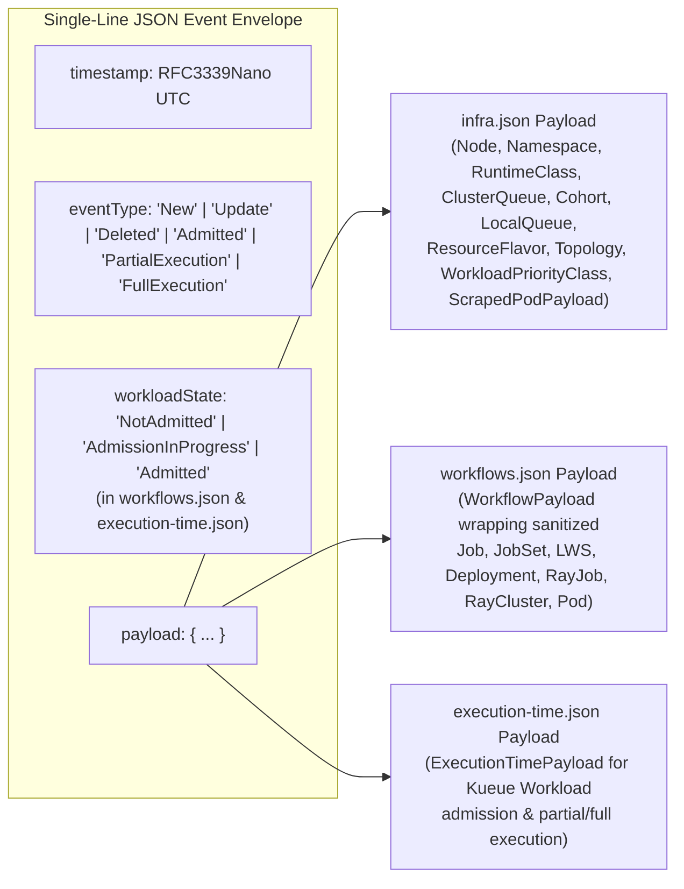
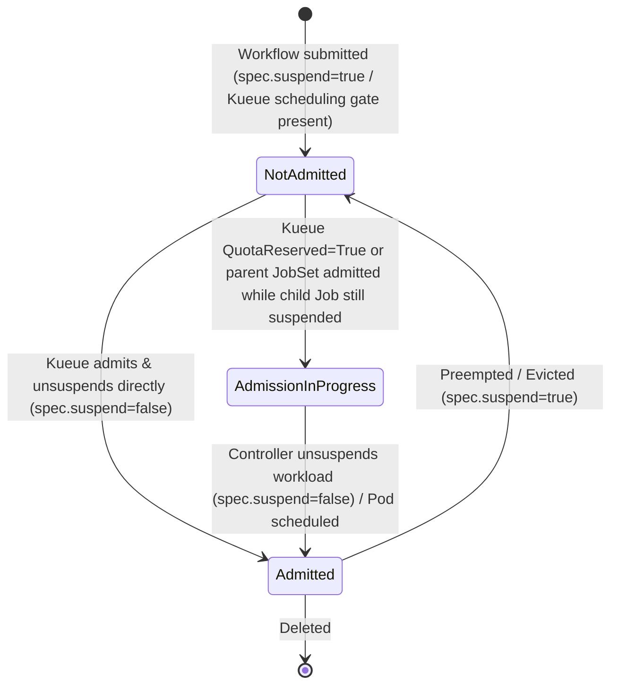
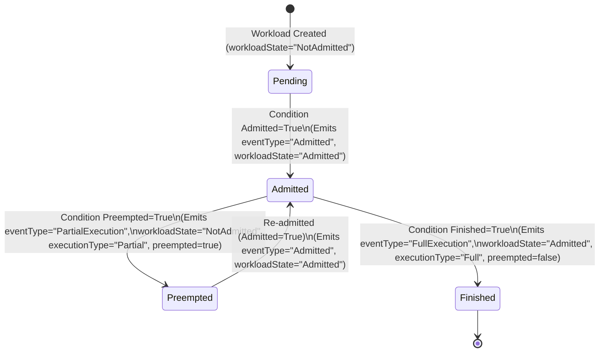

# Kubernetes & Kueue Load Test Cluster Scraper — Output Format & Schema Specification (`SCRAPER-SCHEMA.md`)

This document specifies the exact JSON Lines (NDJSON) file format, event envelope structure, workload admission state metadata (`workloadState`), payload schemas, sanitization rules, and anonymization behavior produced by `cluster-scraper` (`./scraper`).

---

## 1. Overview

`cluster-scraper` connects to a Kubernetes + Kueue cluster and records cluster state, submitted workflows, and workload execution timings into three streaming JSON Lines event log files:

| File | Default Flag | Purpose |
| :--- | :--- | :--- |
| `infra.json` | `--infra-file` | Periodic state & changes of sanitized `Node`s (scheduling-relevant spec & status), `Namespace`s, `RuntimeClass`es, `ClusterQueue`s, `Cohort`s, `LocalQueue`s, `ResourceFlavor`s, `Topology` objects, `WorkloadPriorityClass`es (without status, with annotations filtered), and scheduled/running `Pod` placements, resource requests, and lifecycle timestamps. |
| `workflows.json` | `--workflows-file` | Watch-driven creation, update, and deletion events of `Job`s, `JobSet`s, `LeaderWorkerSet`s, `Deployment`s (excluding unqueued system-namespace `Deployment`s), `RayJob`s, `RayCluster`s, and standalone Kueue-managed `Pod`s, with top-level `workloadState` admission metadata (`"NotAdmitted"`, `"AdmissionInProgress"`, `"Admitted"`) and payloads sanitized of all business-specific details. |
| `execution-time.json` | `--execution-time-file` | Watch-driven Kueue `Workload` admission timestamps (`Admitted`), preempted runs (`PartialExecution`), and non-preempted completions (`FullExecution`), with top-level `workloadState` metadata. |

### On-Disk File Format (One Event Per Line / JSON Lines)
Each output file is written in **JSON Lines (NDJSON)** format:
- **One event per line**: Every line in `infra.json`, `workflows.json`, and `execution-time.json` is an independent, compact (non-pretty-printed) UTF-8 JSON object terminated by a single newline (`\n`).
- **No outer array wrapper**: Files do **not** wrap events in `[` ... `]`, so consumers never need to load or parse the entire file in memory.
- **Append-only streaming**: As each event arrives, `JSONEventLog` serializes the event on a single line (`json.Marshal(event)` + `\n`), appends it to the file (`O_APPEND`), and `fsync`s.
- **$O(1)$-memory line-by-line parsing**: Consumers can stream and parse arbitrarily large trace files one line at a time (`bufio.Scanner` / `json.Unmarshal` in Go, `for line in f: json.loads(line)` in Python, `jq -c`, etc.).

#### On-Disk Single-Line Format Examples
- `infra.json` (2 lines):
```json
{"timestamp":"2026-10-30T12:06:03.831680565Z","eventType":"New","payload":{"apiVersion":"v1","kind":"Pod","name":"jobset-01-workers-0-0-lmxm2","namespace":"ai-lab","placement":"kwok-node-0","resourceRequest":{"cpu":"1","memory":"11Gi"},"schedulingTime":"2026-10-30T12:06:01Z","firstNoticeTime":"2026-10-30T12:06:01Z"}}
{"timestamp":"2026-10-30T12:09:17.68496896Z","eventType":"Deleted","payload":{"apiVersion":"v1","kind":"Pod","name":"jobset-01-workers-0-0-lmxm2","namespace":"ai-lab","placement":"kwok-node-0","resourceRequest":{"cpu":"1","memory":"11Gi"},"schedulingTime":"2026-10-30T12:06:01Z","firstNoticeTime":"2026-10-30T12:06:01Z","deletionTime":"2026-10-30T12:09:17Z"}}
```
- `workflows.json` (2 lines):
```json
{"timestamp":"2026-10-30T12:06:01.456886929Z","eventType":"New","workloadState":"NotAdmitted","payload":{"objectKind":"JobSet","name":"jobset-01","namespace":"ai-lab","creationTime":"2026-10-30T12:06:01Z","localQueueName":"ai-lab-lq","object":{...}}}
{"timestamp":"2026-10-30T12:06:01.511203122Z","eventType":"Update","workloadState":"Admitted","payload":{"objectKind":"JobSet","name":"jobset-01","namespace":"ai-lab","creationTime":"2026-10-30T12:06:01Z","localQueueName":"ai-lab-lq","object":{...}}}
```
- `execution-time.json` (2 lines):
```json
{"timestamp":"2026-10-30T12:06:01.494857597Z","eventType":"Admitted","workloadState":"Admitted","payload":{"workloadName":"jobset-jobset-01-3165a","namespace":"ai-lab","ownerKind":"JobSet","ownerName":"jobset-01","ownerAPIVersion":"jobset.x-k8s.io/v1alpha2","localQueueName":"ai-lab-lq","clusterQueueName":"ai-lab-cq","creationTime":"2026-10-30T12:06:01Z","admittedTime":"2026-10-30T12:06:01Z","preempted":false,"reason":"Admitted","message":"The workload is admitted"}}
{"timestamp":"2026-10-30T12:06:12.878986519Z","eventType":"FullExecution","workloadState":"Admitted","payload":{"executionType":"Full","workloadName":"jobset-jobset-01-3165a","namespace":"ai-lab","ownerKind":"JobSet","ownerName":"jobset-01","ownerAPIVersion":"jobset.x-k8s.io/v1alpha2","localQueueName":"ai-lab-lq","clusterQueueName":"ai-lab-cq","creationTime":"2026-10-30T12:06:01Z","admittedTime":"2026-10-30T12:06:01Z","endTime":"2026-10-30T12:06:12Z","executionDurationSeconds":11,"executionDuration":"11s","preempted":false,"reason":"Succeeded","message":"jobset completed successfully"}}
```

---

## 2. Common Event Envelope (All Files)

In **all three files** (`infra.json`, `workflows.json`, and `execution-time.json`), every line is an independent JSON object sharing a top-level envelope that strictly separates **event metadata** (`timestamp`, `eventType`, and for workload files `workloadState`) from the **event payload** (`payload`).

On disk (single line in `workflows.json` and `execution-time.json`):
```json
{"timestamp":"2026-10-30T12:06:01.494857597Z","eventType":"New","workloadState":"NotAdmitted","payload":{...}}
```

On disk (single line in `infra.json`):
```json
{"timestamp":"2026-10-30T12:06:01.494857597Z","eventType":"New","payload":{...}}
```

Expanded view (for schema readability only):
```json
{
  "timestamp": "2026-10-30T12:06:01.494857597Z",
  "eventType": "New",
  "workloadState": "NotAdmitted",
  "payload": {
    ...
  }
}
```

### Envelope Fields

| Field | JSON Type | Present In | Description |
| :--- | :--- | :--- | :--- |
| `timestamp` | `string` (RFC3339Nano UTC) | All 3 files (**Required**) | Wall-clock UTC timestamp when the scraper observed and recorded the event (e.g., `"2026-10-30T12:06:01.494857597Z"`). |
| `eventType` | `string` (PascalCase) | All 3 files (**Required**) | Type of event. Always starts with an uppercase letter:<ul><li>In `infra.json` and `workflows.json`: `"New"`, `"Update"`, `"Deleted"`</li><li>In `execution-time.json`: `"Admitted"`, `"PartialExecution"`, `"FullExecution"`</li></ul> |
| `workloadState` | `string` (PascalCase) | `workflows.json` & `execution-time.json` (**Required**) | Current admission state of the workload at the moment the event was recorded. Always one of:<ul><li>`"NotAdmitted"` — Workload is queued/suspended waiting for quota or has been preempted/evicted.</li><li>`"AdmissionInProgress"` — Quota is reserved (`QuotaReserved=True`) or parent `JobSet` is admitted while child resources (`Job`, pod group) are still being unsuspended/admitted.</li><li>`"Admitted"` — Workload has been admitted by Kueue (`Admitted=True`) and unsuspended (`spec.suspend=false`).</li></ul> |
| `payload` | `object` | All 3 files (**Required**) | Event-specific payload object whose schema depends on the file and resource kind (detailed in Sections 3, 4, and 5). |



---

## 3. `infra.json` Schema

`infra.json` records periodic snapshots (every `--interval`, default `60s`) of cluster infrastructure resources and combines periodic scraping with a real-time `v1/Pod` watch to track scheduled and running pods and their exact deletion timestamps.

### 3.1 Allowed `eventType` Values in `infra.json`

| `eventType` | Emission Trigger |
| :--- | :--- |
| `"New"` | Emitted the first time an object (`Node`, `Namespace`, `RuntimeClass`, `ClusterQueue`, `Cohort`, `LocalQueue`, `ResourceFlavor`, `Topology`, `WorkloadPriorityClass`, or scheduled/running `Pod`) is observed by the scraper. |
| `"Update"` | Emitted on a periodic scrape tick when a tracked object's canonical SHA-256 digest (ignoring volatile `metadata.resourceVersion`) changes compared to its previously recorded state. |
| `"Deleted"` | Emitted when a previously observed infrastructure object disappears between periodic scrapes, or immediately when a tracked `Pod` receives a `DELETED` watch event. |

### 3.2 Discriminating Payload Types in `infra.json`

Every `payload` object in `infra.json` contains top-level `"apiVersion"` and `"kind"` fields:

| `payload.kind` | `payload.apiVersion` | Includes `.status`? | Name Hashed with `--hash-names`? |
| :--- | :--- | :--- | :--- |
| `"Node"` | `"v1"` | **Yes** (scheduling-only: `capacity`, `allocatable`, `conditions`, `phase`) | **No** (plain name) |
| `"Namespace"` | `"v1"` | **No** (status omitted) | **No** (plain name) |
| `"RuntimeClass"` | `"node.k8s.io/v1"` | **No** (status omitted) | **No** (plain name) |
| `"ClusterQueue"` | `"kueue.x-k8s.io/v1beta2"` | **No** (status omitted) | **No** (plain name) |
| `"Cohort"` | `"kueue.x-k8s.io/v1beta2"` | **No** (status omitted) | **No** (plain name) |
| `"LocalQueue"` | `"kueue.x-k8s.io/v1beta2"` | **No** (status omitted) | **No** (plain name) |
| `"ResourceFlavor"` | `"kueue.x-k8s.io/v1beta2"` | **No** (status omitted) | **No** (plain name) |
| `"Topology"` | `"kueue.x-k8s.io/v1beta2"` | **No** (status omitted) | **No** (plain name) |
| `"WorkloadPriorityClass"` | `"kueue.x-k8s.io/v1beta2"` | **No** (status & description omitted) | **No** (plain name) |
| `"Pod"` | `"v1"` | **No** (`ScrapedPodPayload` only) | **Yes** (SHA-256 hex when `--hash-names` is set) |

---

### 3.3 `Node` Payload (`payload.kind == "Node"`)

Stores a sanitized Kubernetes `v1/Node` object retaining only scheduling-relevant fields:
- `metadata`: `metadata.managedFields` is stripped, `metadata.annotations` retains only keys under the `kubernetes.io`, `k8s.io`, `x-k8s.io`, and `kueue-optimizer.gke.io` domains and their subdomains (excluding sensitive keys such as `kubectl.kubernetes.io/last-applied-configuration`, `csi.volume.kubernetes.io/nodeid`, and `alpha.kubernetes.io/provided-node-ip`), and `metadata.labels` preserves scheduling/topology/hardware labels while stripping cloud/cluster-identifying keys (such as `cloud.google.com/gke-cluster-name`, `cloud.google.com/project`, `iam.gke.io/node-service-account`, `alpha.eksctl.io/cluster-name`, and `kubernetes.azure.com/cluster`) and (when `--hash-names` is enabled) deterministically hashing values for sensitive keys (`owner`, `team`, `customer`, `project`, `cost-center`, ...) and `--extra-hash-labels`.
- `spec`: retains only `taints` and `unschedulable` (omitting `providerID`, `podCIDR`, `podCIDRs`, and `configSource`).
- `status`: retains only `capacity`, `allocatable`, `conditions`, and `phase` (omitting `images`, `addresses`, `nodeInfo`, `volumesInUse`, `volumesAttached`, `daemonEndpoints`, `config`, `runtimeHandlers`, and `features`).

On disk (single line in `infra.json`):
```json
{"timestamp":"2026-10-30T12:05:53.431067532Z","eventType":"New","payload":{"apiVersion":"v1","kind":"Node","metadata":{"annotations":{"kwok.x-k8s.io/node":"fake"},"creationTimestamp":"2026-10-30T12:05:13Z","labels":{"beta.kubernetes.io/arch":"amd64","beta.kubernetes.io/os":"linux","kubernetes.io/arch":"amd64","kubernetes.io/hostname":"kwok-node-0","kubernetes.io/os":"linux","kubernetes.io/role":"agent","type":"kwok"},"name":"kwok-node-0","resourceVersion":"324","uid":"a4971110-16a8-4b65-a2a0-01ef11df47a2"},"spec":{"taints":[{"effect":"NoSchedule","key":"kwok.x-k8s.io/node","value":"fake"}]},"status":{"allocatable":{"cpu":"4","memory":"16Gi","pods":"110"},"capacity":{"cpu":"4","memory":"16Gi","pods":"110"},"conditions":[{"lastHeartbeatTime":"2026-10-30T12:05:44Z","lastTransitionTime":"2026-10-30T12:05:14Z","message":"kubelet is posting ready status","reason":"KubeletReady","status":"True","type":"Ready"}],"phase":"Running"}}}
```

---

### 3.4 `Namespace`, `RuntimeClass`, `ClusterQueue`, `Cohort`, `LocalQueue`, `ResourceFlavor`, `Topology`, and `WorkloadPriorityClass` Payloads

Stores the Kubernetes/Kueue object (`apiVersion`, `kind`, `metadata`, plus `spec` or top-level `RuntimeClass`/`WorkloadPriorityClass` scheduling fields), **excluding `.status`**, `WorkloadPriorityClass.description`, `metadata.managedFields`, and any `metadata.annotations` outside the allowed `kubernetes.io`, `k8s.io`, `x-k8s.io`, and `kueue-optimizer.gke.io` domains (and their subdomains) or on the sensitive annotation denylist. When `--hash-names` is enabled, values for sensitive label keys (`owner`, `team`, `customer`, `project`, `cost-center`, ...) and `--extra-hash-labels` (including `ClusterQueue.spec.namespaceSelector`, `ResourceFlavor.spec.nodeLabels`, and `RuntimeClass.scheduling.nodeSelector`) are deterministically hashed (`h-<32-hex>`) identically to workflow objects.

On disk (single line in `infra.json` for `ClusterQueue`):
```json
{"timestamp":"2026-10-30T12:05:53.443652256Z","eventType":"New","payload":{"apiVersion":"kueue.x-k8s.io/v1beta2","kind":"ClusterQueue","metadata":{"creationTimestamp":"2026-10-30T12:05:14Z","finalizers":["kueue.x-k8s.io/resource-in-use"],"generation":1,"name":"ai-lab-cq","resourceVersion":"249","uid":"68ce46db-48b0-4271-903a-d6eb4819ab56"},"spec":{"namespaceSelector":{},"preemption":{"reclaimWithinCohort":"Never","withinClusterQueue":"Never"},"queueingStrategy":"StrictFIFO","resourceGroups":[{"coveredResources":["cpu","memory"],"flavors":[{"name":"default-flavor","resources":[{"name":"cpu","nominalQuota":"40"},{"name":"memory","nominalQuota":"160Gi"}]}]}]}}}
```

On disk (single line in `infra.json` for `Cohort`):
```json
{"timestamp":"2026-10-30T12:05:53.450112904Z","eventType":"New","payload":{"apiVersion":"kueue.x-k8s.io/v1beta2","kind":"Cohort","metadata":{"creationTimestamp":"2026-10-30T12:05:14Z","generation":1,"name":"main-cohort","resourceVersion":"245","uid":"9f2b1b24-1b7d-4e54-8f31-18e62f9a3d10"},"spec":{"fairSharing":{"weight":"2"},"parentName":"root-cohort","resourceGroups":[{"coveredResources":["cpu"],"flavors":[{"name":"default-flavor","resources":[{"borrowingLimit":"8","lendingLimit":"4","name":"cpu","nominalQuota":"16"}]}]}]}}}
```

---

### 3.5 Scheduled & Running `Pod` Payload (`ScrapedPodPayload`, `payload.kind == "Pod"`)

Only pods that have been scheduled onto a node (`spec.nodeName != ""`) and reached `status.phase == "Running"` are recorded in `infra.json`.

To guarantee strict data hygiene, **no other pod fields are ever written to `infra.json`**. Specifically, container specs, container statuses, images, execution arguments, commands, environment variables, secrets, volumes, annotations, and labels are completely omitted.

#### `ScrapedPodPayload` Fields

| Field | JSON Type | Required | Description |
| :--- | :--- | :--- | :--- |
| `apiVersion` | `string` | **Yes** | Always `"v1"`. |
| `kind` | `string` | **Yes** | Always `"Pod"`. |
| `name` | `string` | **Yes** | Pod name (or `h-<32-hex>` HMAC-SHA256 hash when `--hash-names` is enabled). |
| `namespace` | `string` | **Yes** | Plain (unhashed) namespace name. |
| `placement` | `string` | **Yes** | Plain (unhashed) node name (`spec.nodeName`) where the pod is scheduled and running. |
| `resourceRequest` | `map[string]Quantity` | **Yes** | Effective pod resource requests (e.g., `{"cpu": "1", "memory": "11Gi"}`). Computed using Kubernetes scheduling rules:<br>$\text{Request}(r) = \max\Big(\text{PodRequest}(r),\; \max_{i \in \text{Init}}(\text{Init}_i(r)),\; \sum_{c \in \text{Containers}} \text{Container}_c(r) + \sum_{s \in \text{Sidecars}} \text{Sidecar}_s(r)\Big) + \text{PodOverhead}(r)$ |
| `schedulingTime` | `string` (RFC3339 UTC) | Optional | Timestamp when the pod was scheduled onto its node, extracted from the `PodScheduled` condition's `lastTransitionTime` (falling back to `status.startTime` or `metadata.creationTimestamp`). Preserved across later pod status updates. |
| `firstNoticeTime` | `string` (RFC3339 UTC) | **Yes** | Timestamp when the scraper first observed the scheduled pod (via watch or periodic scrape). |
| `deletionTime` | `string` (RFC3339 UTC) | Optional | Present on `"Deleted"` events. Timestamp when the pod was deleted (`metadata.deletionTimestamp` if set on the watch event, or watch `DELETED` arrival time). |

#### On-Disk Single-Line Examples (`New` and `Deleted` Pod Events in `infra.json`):
```json
{"timestamp":"2026-10-30T12:06:03.831680565Z","eventType":"New","payload":{"apiVersion":"v1","kind":"Pod","name":"jobset-01-workers-0-0-lmxm2","namespace":"ai-lab","placement":"kwok-node-0","resourceRequest":{"cpu":"1","memory":"11Gi"},"schedulingTime":"2026-10-30T12:06:01Z","firstNoticeTime":"2026-10-30T12:06:01Z"}}
{"timestamp":"2026-10-30T12:09:17.68496896Z","eventType":"Deleted","payload":{"apiVersion":"v1","kind":"Pod","name":"jobset-01-workers-0-0-lmxm2","namespace":"ai-lab","placement":"kwok-node-0","resourceRequest":{"cpu":"1","memory":"11Gi"},"schedulingTime":"2026-10-30T12:06:01Z","firstNoticeTime":"2026-10-30T12:06:01Z","deletionTime":"2026-10-30T12:09:17Z"}}
```

---

## 4. `workflows.json` Schema

`workflows.json` records real-time watch events (`"New"`, `"Update"`, `"Deleted"`) for workload objects submitted to the cluster:

1. `Job` (`batch/v1`)
2. `JobSet` (`jobset.x-k8s.io/v1alpha2`)
3. `LeaderWorkerSet` (`leaderworkerset.x-k8s.io/v1`)
4. `Deployment` (`apps/v1`) — unqueued `Deployment`s in Kubernetes/GKE/controller system namespaces (`kube-*`, `kueue-system`, `jobset-system`, `leaderworkerset-system`, `ray-system`, `cert-manager`, `gmp-*`, `gke-managed-*`, etc.) are automatically filtered out.
5. `RayJob` (`ray.io/v1`)
6. `RayCluster` (`ray.io/v1`)
7. Standalone Kueue-managed `Pod` (`v1/Pod`) — a Pod that is marked for Kueue scheduling (`kueue.x-k8s.io/queue-name` label/annotation, `kueue.x-k8s.io/managed=true` label, or Kueue scheduling gates) **and** does not belong to any of the parent workflow APIs above (`ownerReferences`, `kueue.x-k8s.io/pod-suspending-parent`, `job-name`, `jobset.sigs.k8s.io/jobset-name`, `leaderworkerset.sigs.k8s.io/name`, or `ray.io/cluster`).

### 4.1 How `workloadState` Is Determined in `workflows.json`

Every event in `workflows.json` carries `"workloadState"` in its top-level metadata (`"NotAdmitted"`, `"AdmissionInProgress"`, or `"Admitted"`), next to `"timestamp"` and `"eventType"`. Whenever an object's `workloadState` transitions (even if its sanitized spec did not otherwise change), `cluster-scraper` emits an `"Update"` event.

| Workflow Kind | `"NotAdmitted"` | `"AdmissionInProgress"` | `"Admitted"` |
| :--- | :--- | :--- | :--- |
| **`JobSet`, `RayJob`, `RayCluster`** | `spec.suspend == true` and Kueue `Workload` has not reserved quota (`QuotaReserved != True`), or `Workload` was preempted/evicted. | `spec.suspend == true` while the backing Kueue `Workload` has `QuotaReserved=True` (`Admitted != True`). | `spec.suspend == false` (or backing Kueue `Workload` has `Admitted=True`). |
| **`Job` (`batch/v1`)** | `spec.suspend == true`, parent `JobSet` (if any) is not admitted, and backing Kueue `Workload` does not have `QuotaReserved=True`. | `spec.suspend == true` while its parent `JobSet` is already `"Admitted"` / `"AdmissionInProgress"`, or while its backing Kueue `Workload` has `QuotaReserved=True`. | `spec.suspend == false` (unsuspended for execution). |
| **`LeaderWorkerSet`, `Deployment`** | Backing Kueue `Workload` is `"NotAdmitted"`, or (before `Workload` is observed) the object has a `kueue.x-k8s.io/queue-name` and `status.readyReplicas == 0`. | Backing Kueue `Workload` is in `"AdmissionInProgress"` (`QuotaReserved=True` and `Admitted != True`), or pods are starting (`status.replicas > 0` and `status.readyReplicas == 0` when unqueued). | Backing Kueue `Workload` is `"Admitted"`, or `status.readyReplicas > 0`. |
| **Standalone Kueue `Pod`** | `spec.schedulingGates` contains a Kueue gate (`kueue.x-k8s.io/*`) and backing `Workload` is not in progress. | Kueue scheduling gates have been removed (`len(kueueGates) == 0`) and `spec.nodeName == ""` (waiting for `kube-scheduler` binding), or backing `Workload` has `QuotaReserved=True`. | `spec.nodeName != ""` (or backing `Workload` is `"Admitted"` without scheduling gates). |



### 4.2 `WorkflowPayload` Schema (`payload` in `workflows.json`)

| Field | JSON Type | Required | Description |
| :--- | :--- | :--- | :--- |
| `objectKind` | `string` | **Yes** | One of `"Job"`, `"JobSet"`, `"LeaderWorkerSet"`, `"Deployment"`, `"RayJob"`, `"RayCluster"`, `"Pod"`. |
| `name` | `string` | **Yes** | Workflow object name (or `h-<32-hex>` HMAC-SHA256 hash when `--hash-names` is enabled). |
| `namespace` | `string` | **Yes** | Plain (unhashed) namespace name. |
| `creationTime` | `string` (RFC3339 UTC) | **Yes** | `metadata.creationTimestamp` of the workflow object. |
| `localQueueName` | `string` | **Yes** | Plain (unhashed) Kueue `LocalQueue` name extracted from `kueue.x-k8s.io/queue-name` (on the object's labels/annotations, pod template labels, or inherited from the parent `JobSet` for child `Job`s). Empty string `""` if the object is not associated with a Kueue queue. |
| `object` | `object` | **Yes** | The Kubernetes resource object as submitted to the cluster (`apiVersion`, `kind`, `metadata`, `spec`), sanitized according to Section 4.3. |

### 4.3 Sanitization Rules Applied to `payload.object`

Every workflow object in `workflows.json` is sanitized before being hashed for change detection or written to disk:

1. **Container Image & Command Replacement**:
   - All `containers`, `initContainers`, and `ephemeralContainers` (as well as `RayCluster` `autoscalerOptions.image` and `historyServerOptions.collectorOptions.image` when set) have their `image` replaced with the pause container image (`registry.k8s.io/pause:3.10` by default, configurable via `--pause-image`) and `command` set to `nil`.
2. **Command-Line Arguments & Job Metadata Stripped**:
   - Container and `RayCluster.spec.autoscalerOptions` `args` are set to `nil`.
   - `RayJob.spec.entrypoint`, `RayJob.spec.runtimeEnvYAML`, and `RayJob.spec.jobId` are cleared (`""`), and `RayJob.spec.metadata` is set to `nil`.
   - `RayCluster` head and worker group `rayStartParams` are cleared (`nil`).
3. **Volumes Stripped**:
   - `spec.volumes`, container/`autoscalerOptions` `volumeMounts`, and container `volumeDevices` are set to `nil`.
   - `LeaderWorkerSet.spec.leaderWorkerTemplate.volumeClaimTemplates` and `JobSet.spec.volumeClaimPolicies` are set to `nil`.
4. **Secrets, Credentials & Endpoints Stripped**:
   - `spec.imagePullSecrets`, secret volumes, secret environment references, `RayCluster.spec.gcsFaultToleranceOptions`, `RayCluster.spec.authOptions.secretName`, `RayCluster.spec.networkPolicy`, `HeadGroupSpec.ingressOptions`/`enableIngress`, and `HeadService.spec` static IPs/CIDRs/`externalName` (preserving `clusterIP: "None"` for headless services) are cleared.
5. **Environment Variables Stripped**:
   - `env` and `envFrom` are omitted across all containers (`containers`, `initContainers`, `ephemeralContainers`), as well as `RayCluster` `autoscalerOptions` (`env`, `envFrom`) and `historyServerOptions.collectorOptions` (`env`).
6. **Probes, Lifecycle Hooks, and Pod/JobSet Identity & Network Fields Stripped**:
   - Container `livenessProbe`, `readinessProbe`, `startupProbe`, and `lifecycle` (`postStart` / `preStop`) fields are omitted across `containers`, `initContainers`, and `ephemeralContainers`.
   - Pod `serviceAccountName` (and legacy `serviceAccount`), `hostname`, `hostnameOverride`, `subdomain`, `hostAliases`, and `dnsConfig` fields, as well as `JobSet.spec.network.subdomain`, are omitted.
7. **Annotation Filtering**:
   - Applied to top-level `metadata.annotations` and nested `JobTemplateSpec`, `PodTemplateSpec`, and `Service` `metadata.annotations`.
   - **Allowed domains** (exact or subdomain, case-insensitive): `kubernetes.io`, `k8s.io`, `x-k8s.io`, `kueue-optimizer.gke.io`. Custom domains (even if containing `k8s` or `kubernetes` as substrings) and unprefixed keys are stripped.
   - **Sensitive denylist** (always stripped even under allowed domains): `kubectl.kubernetes.io/last-applied-configuration`, `kubernetes.io/change-cause`, `kubernetes.io/description`, `kubernetes.io/service-account.name`, `kubernetes.io/service-account.uid`, `pod.alpha.kubernetes.io/init-containers`, `pod.beta.kubernetes.io/init-containers`, `pod.alpha.kubernetes.io/init-container-statuses`, `pod.beta.kubernetes.io/init-container-statuses`, `csi.volume.kubernetes.io/nodeid`, `alpha.kubernetes.io/provided-node-ip`.
8. **Salted Deterministic Label Value Hashing (When `--hash-names` Is Enabled)**:
   - **Only label values are hashed**: Matching labels have their **values** replaced with `h-<first-32-hex-chars>` (34 characters `<= 63`-char Kubernetes label limit); label **keys** are never hashed.
   - **Key management**: When `--hash-names` is enabled, `Scraper` initializes `SensitiveDataHasher` with a fresh in-memory 256-bit `crypto/rand` key (never logged or written to disk) to compute `HMAC-SHA256` digests. When `--hash-names` is disabled, `NoopHasher` leaves names and label values unchanged.
   - **Where applied (values only)**: Top-level `metadata.labels`, nested `JobTemplateSpec` / `PodTemplateSpec` / `Ray` group `labels`, `spec.selector` (`matchLabels` values and `matchExpressions[].values`), `HeadService.spec.selector`, `RayJob.spec.clusterSelector`, and `PodSpec` scheduling constraints (`nodeSelector`, `affinity`, `topologySpreadConstraints`).
   - **Matched keys**:
     - Organizational/identity keys (unprefixed or `<domain>/<name>`): `owner`, `team`, `customer`, `client`, `user`, `username`, `author`, `creator`, `maintainer`, `contact`, `email`, `department`, `org`, `organization`, `cost-center`, `cost_center`, `costcenter`, `billing`, `project`, `account`.
     - Workload-referencing label keys (see Section 6 table).
     - Any additional keys or `<domain>/*` patterns passed via `--extra-hash-labels`.
9. **Status & ManagedFields Stripped**:
   - `.status` and `metadata.managedFields` are removed so only the submitted specification is stored.

### 4.4 On-Disk Single-Line Examples (`New` and `Update` `JobSet` Events in `workflows.json`)

```json
{"timestamp":"2026-10-30T12:06:01.456886929Z","eventType":"New","workloadState":"NotAdmitted","payload":{"objectKind":"JobSet","name":"jobset-01","namespace":"ai-lab","creationTime":"2026-10-30T12:06:01Z","localQueueName":"ai-lab-lq","object":{"apiVersion":"jobset.x-k8s.io/v1alpha2","kind":"JobSet","metadata":{"annotations":{"kueue-optimizer.gke.io/cpu-per-pod":"1","kueue-optimizer.gke.io/mem-per-pod":"11Gi","kueue-optimizer.gke.io/pod-count":"7","kueue-optimizer.gke.io/pod-execution-time-seconds":"10"},"creationTimestamp":"2026-10-30T12:06:01Z","generation":1,"labels":{"kueue.x-k8s.io/queue-name":"ai-lab-lq"},"name":"jobset-01","namespace":"ai-lab","resourceVersion":"274","uid":"d1a4c587-6113-4191-a210-12bd69c0d68c"},"spec":{"replicatedJobs":[{"name":"workers","replicas":1,"template":{"metadata":{},"spec":{"activeDeadlineSeconds":300,"completions":7,"parallelism":7,"template":{"metadata":{"annotations":{"kueue-optimizer.gke.io/pod-execution-time-seconds":"10"}},"spec":{"containers":[{"image":"registry.k8s.io/pause:3.10","name":"worker","resources":{"limits":{"cpu":"1","memory":"11Gi"},"requests":{"cpu":"1","memory":"11Gi"}}}],"restartPolicy":"Never","tolerations":[{"effect":"NoSchedule","key":"kwok.x-k8s.io/node","operator":"Equal","value":"fake"}]}}}}}],"suspend":true}}}}
{"timestamp":"2026-10-30T12:06:01.511203122Z","eventType":"Update","workloadState":"Admitted","payload":{"objectKind":"JobSet","name":"jobset-01","namespace":"ai-lab","creationTime":"2026-10-30T12:06:01Z","localQueueName":"ai-lab-lq","object":{"apiVersion":"jobset.x-k8s.io/v1alpha2","kind":"JobSet","metadata":{"annotations":{"kueue-optimizer.gke.io/cpu-per-pod":"1","kueue-optimizer.gke.io/mem-per-pod":"11Gi","kueue-optimizer.gke.io/pod-count":"7","kueue-optimizer.gke.io/pod-execution-time-seconds":"10"},"creationTimestamp":"2026-10-30T12:06:01Z","generation":2,"labels":{"kueue.x-k8s.io/queue-name":"ai-lab-lq"},"name":"jobset-01","namespace":"ai-lab","resourceVersion":"292","uid":"d1a4c587-6113-4191-a210-12bd69c0d68c"},"spec":{"replicatedJobs":[{"name":"workers","replicas":1,"template":{"metadata":{},"spec":{"activeDeadlineSeconds":300,"completions":7,"parallelism":7,"template":{"metadata":{"annotations":{"kueue-optimizer.gke.io/pod-execution-time-seconds":"10"}},"spec":{"containers":[{"image":"registry.k8s.io/pause:3.10","name":"worker","resources":{"limits":{"cpu":"1","memory":"11Gi"},"requests":{"cpu":"1","memory":"11Gi"}}}],"nodeSelector":{"type":"kwok"},"restartPolicy":"Never","tolerations":[{"effect":"NoSchedule","key":"kwok.x-k8s.io/node","operator":"Equal","value":"fake"}]}}}}}],"suspend":false}}}}
```

---

## 5. `execution-time.json` Schema

`execution-time.json` watches `kueue.x-k8s.io/v1beta2` `Workload` objects and records when each workload is admitted by Kueue and whether its execution ends in preemption (`PartialExecution`) or completion without preemption (`FullExecution`).

### 5.1 Allowed `eventType` and `workloadState` Values in `execution-time.json`

| `eventType` | `workloadState` | `payload.executionType` | Emission Trigger |
| :--- | :--- | :--- | :--- |
| `"Admitted"` | `"Admitted"` | *(omitted)* | Emitted when a Kueue `Workload`'s `Admitted` status condition transitions to `True` (including re-admission after a prior preemption). |
| `"PartialExecution"` | `"NotAdmitted"` | `"Partial"` | Emitted when an admitted `Workload` is preempted (`Preempted=True` condition or `Evicted=True` condition with `Preempted` reason). Records the partial execution duration from `admittedTime` to preemption `endTime`, and transitions `workloadState` back to `"NotAdmitted"`. |
| `"FullExecution"` | `"Admitted"` | `"Full"` | Emitted when an admitted `Workload` reaches `Finished=True` without being preempted during that admission cycle (including when clean completion such as `Reason: Succeeded` wins a race against an in-flight preemption whose `Preempted=True` condition remained latched). Records the full execution duration from `admittedTime` to completion `endTime`. |



### 5.2 `ExecutionTimePayload` Schema (`payload` in `execution-time.json`)

| Field | JSON Type | Required | Description |
| :--- | :--- | :--- | :--- |
| `executionType` | `string` | On execution completion | `"Partial"` on `"PartialExecution"` events; `"Full"` on `"FullExecution"` events; omitted on `"Admitted"` events. |
| `workloadName` | `string` | **Yes** | Kueue `Workload` object name (or `h-<32-hex>` HMAC-SHA256 hash when `--hash-names` is enabled). |
| `namespace` | `string` | **Yes** | Plain (unhashed) namespace name. |
| `ownerKind` | `string` | Optional | Kind of the owning workflow object (e.g., `"JobSet"`, `"Job"`, `"LeaderWorkerSet"`, `"Deployment"`, `"RayJob"`, `"RayCluster"`, `"Pod"`). |
| `ownerName` | `string` | Optional | Name of the owning workflow object (or `h-<32-hex>` HMAC-SHA256 hash when `--hash-names` is enabled). |
| `ownerAPIVersion` | `string` | Optional | API group/version of the owning workflow object (e.g., `"jobset.x-k8s.io/v1alpha2"`). |
| `localQueueName` | `string` | Optional | Plain (unhashed) `LocalQueue` name (`workload.spec.queueName`). |
| `clusterQueueName` | `string` | Optional | Plain (unhashed) `ClusterQueue` name (`workload.status.admission.clusterQueue`). |
| `creationTime` | `string` (RFC3339 UTC) | **Yes** | `metadata.creationTimestamp` of the Kueue `Workload`. |
| `admittedTime` | `string` (RFC3339 UTC) | **Yes** | Timestamp when the `Workload` was admitted (`Admitted` condition `lastTransitionTime`). |
| `endTime` | `string` (RFC3339 UTC) | On `PartialExecution` / `FullExecution` | Preemption timestamp (for `PartialExecution`) or completion timestamp (for `FullExecution`). Omitted on `Admitted` events. |
| `executionDurationSeconds` | `number` (`float64`) | On `PartialExecution` / `FullExecution` | Elapsed execution time in seconds (`endTime - admittedTime`). Omitted on `Admitted` events. |
| `executionDuration` | `string` | On `PartialExecution` / `FullExecution` | Human-readable Go duration string (e.g., `"11s"`, `"1m30s"`). Omitted on `Admitted` events. |
| `preempted` | `boolean` | **Yes** | `true` for `"PartialExecution"`; `false` for `"Admitted"` and `"FullExecution"`. |
| `preemptionCount` | `integer` | Optional | Cumulative number of times this workload has been preempted so far (omitted when `0`). |
| `reason` | `string` | Optional | Kubernetes condition `reason` (e.g., `"Admitted"`, `"InClusterQueue"`, `"Succeeded"`). |
| `message` | `string` | Optional | Human-readable Kubernetes condition `message`. |

### 5.3 On-Disk Single-Line Examples (`Admitted`, `PartialExecution`, and `FullExecution` in `execution-time.json`)

```json
{"timestamp":"2026-10-30T12:06:01.494857597Z","eventType":"Admitted","workloadState":"Admitted","payload":{"workloadName":"jobset-jobset-01-3165a","namespace":"ai-lab","ownerKind":"JobSet","ownerName":"jobset-01","ownerAPIVersion":"jobset.x-k8s.io/v1alpha2","localQueueName":"ai-lab-lq","clusterQueueName":"ai-lab-cq","creationTime":"2026-10-30T12:06:01Z","admittedTime":"2026-10-30T12:06:01Z","preempted":false,"reason":"Admitted","message":"The workload is admitted"}}
{"timestamp":"2026-10-30T12:06:20.104921000Z","eventType":"PartialExecution","workloadState":"NotAdmitted","payload":{"executionType":"Partial","workloadName":"jobset-jobset-01-3165a","namespace":"ai-lab","ownerKind":"JobSet","ownerName":"jobset-01","ownerAPIVersion":"jobset.x-k8s.io/v1alpha2","localQueueName":"ai-lab-lq","clusterQueueName":"ai-lab-cq","creationTime":"2026-10-30T12:06:01Z","admittedTime":"2026-10-30T12:06:05Z","endTime":"2026-10-30T12:06:20Z","executionDurationSeconds":15,"executionDuration":"15s","preempted":true,"preemptionCount":1,"reason":"InClusterQueue","message":"Preempted to accommodate a higher priority workload"}}
{"timestamp":"2026-10-30T12:06:12.878986519Z","eventType":"FullExecution","workloadState":"Admitted","payload":{"executionType":"Full","workloadName":"jobset-jobset-01-3165a","namespace":"ai-lab","ownerKind":"JobSet","ownerName":"jobset-01","ownerAPIVersion":"jobset.x-k8s.io/v1alpha2","localQueueName":"ai-lab-lq","clusterQueueName":"ai-lab-cq","creationTime":"2026-10-30T12:06:01Z","admittedTime":"2026-10-30T12:06:01Z","endTime":"2026-10-30T12:06:12Z","executionDurationSeconds":11,"executionDuration":"11s","preempted":false,"reason":"Succeeded","message":"jobset completed successfully"}}
```

---

## 6. Salted HMAC-SHA256 Name & Label Anonymization (`--hash-names` / `--sha256-names`)

- **Disabled (`--hash-names=false`, default)**: `Scraper` uses `NoopHasher`; names and label values remain in plain text (`--extra-hash-labels` requires `--hash-names`).
- **Enabled (`--hash-names` / `--sha256-names`)**: `Scraper` uses a per-run 256-bit CSPRNG `HMAC-SHA256` key (`HashName`) to deterministically hash both resource names and label values into the same `h-<32-hex>` format (34 characters `<= 63`-char Kubernetes DNS/label limit) so cross-references between object names and label values match 1-to-1:
  - **Workload/workflow/pod names** (plus `ownerReferences` and name-holding annotations).
  - **Sensitive, workload-referencing, and `--extra-hash-labels` label values** (label keys are never hashed).
- **Infrastructure names**: Always kept in plain text so cluster topology and queue hierarchy remain directly inspectable.

| Object Kind | Hashed When `--hash-names` Is Enabled? | Cross-References Also Hashed |
| :--- | :--- | :--- |
| `Node` | **Never hashed** (plain name) | `ScrapedPodPayload.placement` (`spec.nodeName`) is also kept plain |
| `Namespace` | **Never hashed** (plain name) | `metadata.namespace` across all events is kept plain |
| `ClusterQueue` | **Never hashed** (plain name) | `ExecutionTimePayload.clusterQueueName` is kept plain |
| `Cohort` | **Never hashed** (plain name) | `ClusterQueue.spec.cohortName` and `Cohort.spec.parentName` are kept plain |
| `LocalQueue` | **Never hashed** (plain name) | `kueue.x-k8s.io/queue-name`, `WorkflowPayload.localQueueName`, and `ExecutionTimePayload.localQueueName` are kept plain |
| `ResourceFlavor` | **Never hashed** (plain name) | Flavor references in `ClusterQueue` are kept plain |
| `Topology` | **Never hashed** (plain name) | Topology references in `ResourceFlavor` are kept plain |
| `WorkloadPriorityClass` | **Never hashed** (plain name) | `kueue.x-k8s.io/priority-class` label values on workflows/pods are kept plain |
| `RuntimeClass` | **Never hashed** (plain name) | `spec.runtimeClassName` references in pod templates are kept plain |
| `Workload` | **SHA-256 hashed** | `ExecutionTimePayload.workloadName`, `kueue.x-k8s.io/workload`, `kueue.x-k8s.io/workload-slice-name`, `kueue.x-k8s.io/workload-slice-replacement-for` |
| `Pod` | **SHA-256 hashed** | `ScrapedPodPayload.name`, `WorkflowPayload.name`, `metadata.name`, `metadata.generateName` |
| `Job` | **SHA-256 hashed** | `WorkflowPayload.name`, `ExecutionTimePayload.ownerName`, `metadata.ownerReferences`, `job-name`, `batch.kubernetes.io/job-name` |
| `JobSet` | **SHA-256 hashed** | `WorkflowPayload.name`, `ExecutionTimePayload.ownerName`, `metadata.ownerReferences`, `jobset.sigs.k8s.io/jobset-name`, `jobset.sigs.k8s.io/coordinator`, `alpha.jobset.sigs.k8s.io/namespaced-job` |
| `LeaderWorkerSet` | **SHA-256 hashed** | `WorkflowPayload.name`, `ExecutionTimePayload.ownerName`, `metadata.ownerReferences`, `leaderworkerset.sigs.k8s.io/name`, `leaderworkerset.sigs.k8s.io/leader-name`, `leaderworkerset.sigs.k8s.io/leader-address` |
| `Deployment` | **SHA-256 hashed** | `WorkflowPayload.name`, `ExecutionTimePayload.ownerName`, `metadata.ownerReferences`, `app`, `app.kubernetes.io/name`, `app.kubernetes.io/instance` |
| `RayJob` | **SHA-256 hashed** | `WorkflowPayload.name`, `ExecutionTimePayload.ownerName`, `metadata.ownerReferences`, `ray.io/cluster` |
| `RayCluster` | **SHA-256 hashed** | `WorkflowPayload.name`, `ExecutionTimePayload.ownerName`, `metadata.ownerReferences`, `ray.io/cluster` |

---

## 7. Streaming Line-by-Line Reader Examples

### Python
```python
import json

with open("testscenarios/demo/workflows.json", encoding="utf-8") as f:
    for line in f:
        if not line.strip():
            continue
        event = json.loads(line)
        ts = event["timestamp"]
        event_type = event["eventType"]          # "New", "Update", "Deleted"
        workload_state = event["workloadState"]  # "NotAdmitted", "AdmissionInProgress", "Admitted"
        payload = event["payload"]
        kind = payload["objectKind"]             # "Job", "JobSet", "LeaderWorkerSet", "Deployment", "RayJob", "RayCluster", "Pod"
```

### Go
```go
package main

import (
	"bufio"
	"bytes"
	"encoding/json"
	"log"
	"os"
)

func main() {
	f, err := os.Open("testscenarios/demo/execution-time.json")
	if err != nil {
		log.Fatal(err)
	}
	defer f.Close()

	scanner := bufio.NewScanner(f)
	// Increase max line buffer if needed for large Node/JobSet objects in infra.json / workflows.json.
	scanner.Buffer(make([]byte, 64*1024), 16*1024*1024)
	for scanner.Scan() {
		line := bytes.TrimSpace(scanner.Bytes())
		if len(line) == 0 {
			continue
		}
		var ev map[string]any
		if err := json.Unmarshal(line, &ev); err != nil {
			log.Fatal(err)
		}
		// Process ev["timestamp"], ev["eventType"], ev["workloadState"], ev["payload"]
	}
	if err := scanner.Err(); err != nil {
		log.Fatal(err)
	}
}
```
